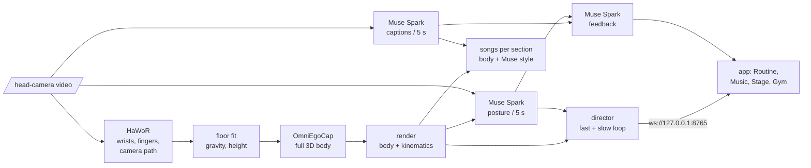

<p align="center">
  <picture>
    <source media="(prefers-color-scheme: dark)" srcset="docs/brand/logo-wordmark-on-dark.svg">
    
  </picture>
</p>

<h3 align="center">One head camera. Your whole body in 3D. Meta Muse Spark turns how you move into music, light and a live stage show.</h3>

<p align="center">
  <a href="#built-with-meta"></a>
  <a href="#built-with-meta"></a>
  <a href="#how-it-works"></a>
  <a href="#quick-start"></a>
  <a href="LICENSE"></a>
</p>

<p align="center">
  <a href="#lifelens-at-a-glance">At a glance</a> ·
  <a href="#demo">Demo</a> ·
  <a href="#what-lifelens-does">Features</a> ·
  <a href="#built-with-meta">Built with Meta</a> ·
  <a href="#how-it-works">How it works</a> ·
  <a href="#quick-start">Quick start</a> ·
  <a href="#results">Results</a> ·
  <a href="#what-we-built-during-the-hackathon">What we built</a> ·
  <a href="#team">Team</a>
</p>

---

## LifeLens at a glance

| | |
|---|---|
| **Problem** | Head cameras and smart glasses never see your own body, so how you move through your day is lost. |
| **Solution** | Rebuild your full 3D body from one head-mounted video, then let Meta Muse Spark understand that movement: it designs a light show, picks music that follows your body and writes a timeline of your day. |
| **Problem statement** | **Push the Frontier:** full-body 3D motion from a camera that never sees the body is an open research problem in computer vision and robotics. |
| **Meta models** | **Meta Muse Spark** (`muse-spark-1.3`, Meta Model API) in 9 places, every call visible live in the app · **Meta Llama 3.2 3B** (open weights, local via Ollama) as the offline fallback |
| **Meta hardware** | **Meta Ray-Ban glasses** are one of the supported cameras, next to a phone and a GoPro |
| **Technical depth** | 3D body from egocentric video (HaWoR + DROID-SLAM + OmniEgoCap) · an agentic two-loop show director that plans, checks and acts in real time · checked AI answers with retry and fallback |
| **Built this week** | The app, the director, every Muse Spark integration, Stagify, live sessions, light output and the evaluation, all built Oct 26 to Nov 4 ([what's ours](#what-we-built-during-the-hackathon)) |
| **Proof** | Body error **102.6 mm** on 3 OmniEgoDB sequences, against **111.7 mm** in the original paper · Muse reply time cut from **16 s to 8 s** by tuning reasoning effort |
| **Real-world impact** | Dancers and performers get a light show that follows their own body, with no motion-capture suit · music that moves with you · a searchable record of how you moved through your day, all from a camera people already wear |
| **Bonus fit** | Agentic: the show director plans, checks each Muse answer and acts in real time · Creative: a live light show and music driven by your own body |
| **Try it** | 4 commands, no GPU needed for the example recordings ([Quick start](#quick-start)) |

## Why LifeLens

Smart glasses and head cameras are becoming everyday devices, but they only see what is **in front** of you. They never see your own body: how you walk, sit, bend, train or perform. So the most personal data they could give you, how you move through your day, is lost.

**LifeLens recovers it.** From a single head-mounted video (a phone, a GoPro or Meta Ray-Ban glasses) it rebuilds your **full 3D body**, even though the camera never sees it. Then **Meta Muse Spark** turns that body into something useful:

- 💡 a **lighting designer** that turns your movement into a live stage show,
- 🎵 a **DJ** that picks songs that match your pace and rhythm,
- 🧭 a **day timeline** that shows what you did, second by second,
- 🔴 a **live session** that captions what you are doing as you record.

## Demo

[](docs/lifelens-demo.mp4)

*DEMO_CAPTION*

The footage is our own: head-mounted GoPro clips (`stretching`, `eating`, `snowboarding`, and `snowboard-strap-in`), in [`examples/`](examples) with their 3D bodies and every Muse Spark output.

## What LifeLens does

| | Tab | What you get |
|---|---|---|
| 💡 | **Stage** | Your 3D body performs on a virtual stage, pelvis fixed centre stage, under 6 lights, one per body part, with a scene designed by **Muse Spark as lighting designer**. The stage rig sits underneath. **Stagify** plans a whole show with songs, a show video and a lighting cue file for real lights (Art-Net, Philips Hue). |
| 🎵 | **Music** | Songs picked while the recording is processed: for every ~20 s, your body's **pace, rhythm and arm swing** set the targets and **Muse Spark** names the style. A player with a queue by section; the music follows the movement. Plays through Spotify. |
| 🧭 | **Routine** | Your recording as a timeline: what you did (Muse captions), your posture every second (Muse Spark), walking speed, a film strip, **what Muse Spark sees now** (the frames it labelled) and its **feedback**, compared with your other recordings. |
| 🏋️ | **Gym** | **Gymify:** Muse Spark recognises the exercise; LifeLens measures reps, sets, range of motion, tempo and left-right difference on the 3D joints. Your 3D body on a gym stage with a joint-angle gauge, and **Muse Spark feedback** cards that jump to their rep. |
| 🔴 | **Live session** | Record from your camera while **Muse Spark captions what you are doing** every few seconds. Process it later into the full 3D body, music and show. |

On an everyday recording (eating, desk work), Muse Spark says so and Stage and Gym leave the show and the rep count out.

**Honest by design:** nothing in the app is sample data. Every number comes from a model, a fixed rule on the 3D body or a fixed formula, and [each one is documented](docs/DEEP_DIVE.md#where-every-result-comes-from).

## Built with Meta

| Meta model | Version | How we call it | Role in LifeLens |
|---|---|---|---|
| **Meta Muse Spark** | `muse-spark-1.3` | Meta Model API (`https://api.meta.ai/v1`, `/responses`), from the local server only | The main brain: sees head-camera and 3D body frames, writes captions, posture, feedback, show plans, light scenes and music styles |
| **Meta Llama 3.2** | `llama3.2:3b` (open weights) | Locally through Ollama | Offline fallback for the show director when there is no Muse key or no internet |

Switch between them with `MODEL_PROVIDER=muse` or `MODEL_PROVIDER=ollama` in `director/.env`.

Agentic: the show director plans, checks each Muse answer and acts in real time. Creative: a live light show and music driven by your own body.

Meta's models are not an add-on in LifeLens. They are what turn a 3D skeleton into understanding. **Take Muse Spark out, and LifeLens can still draw a body, but it can no longer tell what you are doing, what the music should be, or what the show should feel like.**

| Where | What Meta Muse Spark does |
|---|---|
| **Captions** | Describes what you are doing from 3 video frames every 5 s |
| **Posture** | Labels your posture every 5 s from a 3D body frame and a head-camera frame of the same moment: the only posture source |
| **Routine feedback** | Reads the posture log, captions, totals and 8 3D body frames, then writes feedback on what you did |
| **Live session** | Captions your camera in real time and names your posture (about 7 s per reply) |
| **Director** | Picks the mood and tempo of the show every ~6 s from a plain-text summary of the movement |
| **Lighting designer** | Chooses each stage scene (palette, beat pattern, focus, strobe) and explains why |
| **Stagify** | Plans a full show: a scene every 10 s and 2–4 music sections |
| **Gymify** | Names the exercise from 3D body and head-camera frames, gives form feedback and picks the music for the reps |
| **Songs** | While processing: names a music style and mood for every ~20 s, and whether the recording is active (exercise, sport, dance) |

Muse Spark never gets a video file, only still frames (448 px JPEG), text, or both:

| Frames from | Used for |
|---|---|
| The head camera | Captions, live captions |
| The 3D body | Routine feedback, stage scenes, Stagify |
| Both, at the same moment | Posture, Gymify (exercise and feedback) |
| None (text only) | The director's mood, the music styles |

**Meta Llama 3.2 (3B, open weights)** is the built-in fallback: with no Muse key, the director runs Llama 3.2 locally through Ollama, so the show keeps working offline.

**The director is an agent.** Every ~6 s it reads what the body is doing, plans the mood and tempo with Muse Spark, checks the answer, and acts on six lights and the music, while a fast loop reacts to every frame.

### How we use the models well

- **Every AI answer is checked before it is used.** The director validates each Muse/Llama reply against a strict schema, retries invalid answers, and keeps the last good scene if a reply still fails, following the verification practices from Meta's *Agents 102* workshop. Muse sees words and frames only, never raw number arrays, so it cannot echo numbers back as facts.
- **We tuned the reasoning effort.** We ran the same recording at different Muse reasoning levels: `low` cut the reply time from about **16 s to 8 s** with equally valid answers in our test (40 calls), so LifeLens supports `MUSE_REASONING=low`.
- **The key never reaches the browser.** All Muse calls go through the local server; the key lives only in the gitignored `director/.env`.
- **Every call is visible, live.** Click the *Meta Muse Spark* badge: a panel lists each call as it happens, with the model ID, the reasoning effort, the time it took, the request and the reply (never the key). The routine feedback also saves its whole prompt, shown under *View Meta Muse Spark prompt payload*.

## How it works



1. **Ingest:** ffmpeg makes a 30 fps working video, at most 1920 px wide, with the preset's lens correction.
2. **HaWoR** ([`hawor_export.py`](pipeline/hawor_export.py)) finds the wrists and 15 finger joints per hand. DROID-SLAM then tracks the camera in 30 s pieces, which are joined by aligning their overlaps.
3. **Floor fit** ([`build_input.py`](pipeline/build_input.py)): a plane through the SLAM points sets "up" and the floor; the first 3 s set the head mount and, with your height, the scale.
4. **OmniEgoCap** ([`run_omniegocap.py`](pipeline/run_omniegocap.py)) infers the 22-joint body from head and wrist motion. The legs are a learned estimate, not seen. The body is then smoothed and HaWoR's fingers are added.
5. **Render** ([`render.py`](pipeline/render.py)): the body from outside, plus a scrolling graph of knee, hip and elbow flexion, trunk lean and walking speed, side by side with the POV (`side_by_side.mp4`).
6. **Captions** ([`describe_muse.py`](pipeline/describe_muse.py)): Muse Spark gets 3 frames per 5 s.
7. **Songs** ([`songs.py`](pipeline/songs.py)): the body's numbers per ~20 s set the song targets; one Muse Spark call names each section's style and whether the recording is active; ReccoBeats picks the songs.
8. **Posture and feedback**: Muse Spark labels each 5 s from a 3D body frame and a head-camera frame ([`posture_muse.py`](director/posture_muse.py)); [`insights.py`](pipeline/insights.py) turns the labels into the time split; Muse Spark writes the feedback ([`routine_tips.py`](director/routine_tips.py)) and saves its whole prompt.

## Quick start

The app opens processed recordings without a GPU. Building a 3D body from a new video needs the pipeline and an NVIDIA GPU ([Process your own video](docs/DEEP_DIVE.md#process-your-own-video)).

You need [Node.js](https://nodejs.org) 18 or newer, Python 3.10 or newer and, for the Muse Spark features, a Meta Muse Spark API key.

```sh
git clone https://github.com/nshreyasvi/LifeLens.git && cd LifeLens
npm install
python -m venv director/venv
director/venv/bin/pip install -r director/requirements.txt     # Windows: director\venv\Scripts\pip
cp director/.env.example director/.env                          # then set MUSE_API_KEY=...
DIRECTOR_PYTHON=director/venv/bin/python npm run dev            # open http://localhost:8000
```

`director/.env` is gitignored and the browser never sees the key. Without it the director runs on its speed rules only, and the app shows no mood or songs rather than made-up ones. With an empty key it falls back to a local Llama 3.2 through Ollama, when one is running. On Windows the dev server finds `director\venv\Scripts\python.exe` by itself.

Add `MUSE_REASONING=low` to `director/.env` for faster Muse Spark replies (about 8 s instead of 16 s, equally valid answers in our test (40 calls)).

## Using the app

**1. Start page.** Enter your name and, optionally, your **height**, **weight** and **age**. They are kept in your browser.

| Field | What it changes |
|---|---|
| Height (cm) | The real size of your 3D body: the world is scaled so the camera sits at your height while you stand at the start ([why](docs/DEEP_DIVE.md#cameras-and-calibration)) |
| Weight (kg), age | Only Muse Spark's routine review and Gymify feedback, as "About the person: 178 cm, 75 kg, 30 years old". The 3D body model has no input for them |

**2. Pick a session.**
- **Open a recording.** Processed sessions open at once. Saved clips in `recordings/` show the camera list, **Process** and **Delete**; several can be queued, and each row shows its progress.
- **New live session.** Your camera becomes the POV, and every 6 s Muse Spark captions two frames and names your posture. Name the recording, pick the camera, **Record**, then **Stop**: the clip is saved, not processed. **Process now** (or later, from Open a recording) builds the 3D body, the music and the stage show. A live 3D body would need about 1–2 fps: an NVIDIA GPU with 16 GB of VRAM or more (RTX 4080/4090 class, estimated; an RTX 4060 Laptop measured 0.3–0.8 fps).

**3. Play** starts the director on the open recording. The tabs:

| Tab | Shows |
|---|---|
| **Routine** | The POV, 3D body and kinematics; the camera the body was made with. **What Muse Spark sees now**: the frames it labelled, its posture and caption. Icon tiles and a posture donut, a timeline (Muse's activities, numbered changes, posture, walking speed), a film strip, Muse's feedback, past routines and "vs. past" bars |
| **Music** | The player and the queue under the video (a section per ~20 s, with Muse's style); the body's features and the song targets |
| **Stage** | The stage show as the main view, the stage rig under it, the player under the 3D body; **Stagify** under the video |
| **Gym** | The 3D body on a gym stage (rep count, joint-angle gauge, head camera); **Run Gymify** under the video; the report below: tiles, rep chart, a per-rep table and **Muse Spark feedback** cards |

Play and restart sit above the video. Body rhythm is shown as repeats per minute (`/min`); song tempos in BPM, as ReccoBeats measures them.

## Results

Measured on an RTX 4060 Laptop (8 GB).

**3D body vs OmniEgoDB's Xsens motion capture.** OmniEgoCap's evaluator, `--input_npz` mode, 13,737 frames:

| | office | outdoor | robothome | all three | paper (20 seq.) |
|---|---|---|---|---|---|
| MPJPE (mm) | 93.9 | 101.7 | 105.6 | **102.6** | 111.7 |
| Hand error (mm) | 159 | 110 | 135 | **134.0** | 166.2 |
| Jerk (km/s³) | 0.02 | 0.03 | 0.01 | **0.016** | 0.073 |

This covers three of the paper's 20 sequences, so it checks the pipeline; it does not rank it. Own-video mode (our SLAM) is not measured against motion capture.

**Posture agreement with the motion-capture labels**, share of seconds:

| | Rules | Muse Spark | Both agree | Always "standing" |
|---|---|---|---|---|
| office (83 s) | 100% | 70% | 70% | 63% |
| outdoor (105 s) | 90% | 72% | 68% | 30% |

Muse Spark labelled posture here from one 3D body frame and the caption per 5 s. Reading the body's numbers instead it agreed more (office 84%, outdoor 79%); from frames alone (3D body + head camera, no text), which is what LifeLens now uses as its only posture source, office fell to 43%. The motion-capture labels come from rules run on the Xsens skeleton, so they favor the rules column: this is agreement, not accuracy. OmniEgoDB was used for this evaluation only and is not in the repo.

**Speed** ([`bench/live_fps.py`](bench/live_fps.py), a 10 s own-video clip):

| Stage | Seconds per video second |
|---|---|
| HaWoR: hands + DROID-SLAM | 30–77 (78–85% of the total) |
| OmniEgoCap | 2.2–3.5 |
| Render | 2.2–3.9 |
| Captions (Muse Spark, one call per 5 s) | 3.4–3.7 |
| Whole pipeline | **39–90**, i.e. 0.3–0.8 fps against the 30 fps of live video |
| Director fast loop | 0.06 ms per frame |

So the 3D body cannot be live on this laptop; it would need a machine 40–90× faster. The live session therefore shows Muse's captions (about 7 s per reply) and builds the body after you stop.

## What we built during the hackathon

Everything in this repo was written by our team between **Oct 26 and Nov 4, 2026**. We build on published research models and data, which we did not write:

| ✅ Built by us this week | 📦 Existing work we use (not ours) |
|---|---|
| The whole app: start screen, Routine, Music, the stage show, Gym, live session | **HaWoR** (hands) and **DROID-SLAM** (camera path) |
| The director: fast loop, slow loop, freeze detection, reactive flash | **OmniEgoCap** (body model and weights) |
| Every Meta Muse Spark and Llama 3.2 integration and prompt | **SMPL-H / MANO** body models |
| The pipeline that connects the models (`pipeline/`): camera presets, GoPro lens metadata, calibration from your height, floor fit, render, songs | **ReccoBeats** (song search) and the **Spotify** player |
| Stagify, Gymify, tempo from the body, songs from movement, the live Meta call log | **OmniEgoDB** (motion capture, for the evaluation only) |
| The example recordings: our own GoPro clips | |
| Real light output (Art-Net, Philips Hue) and cue playback | |
| The evaluation against motion capture | |

## Engineering highlights

- **Fails loudly, never fakes.** If the 3D body cannot be built (for example, too little motion for SLAM), the run stops with the error. It never borrows another recording's body, and the app shows no mood or songs rather than defaults.
- **Measured, not guessed.** Tempo comes from the autocorrelation of all four limbs' speeds. Reps come from the main joint's angle. Freeze detection compares your whole-body motion with your own last 4 s.
- **Real hardware.** The six fixtures stream to DMX over Art-Net or to a Philips Hue bridge, five times a second, and Stagify exports a lighting cue file that `node server/replay.js` plays back.
- **Tested on real recordings.** There are no synthetic tests: the checks run on the real example recordings.

Full detail on recording, calibration, processing, every output and each feature: [docs/DEEP_DIVE.md](docs/DEEP_DIVE.md)

## Limits

- **Legs** are OmniEgoCap's estimate from head and wrist motion; the camera never sees them. Uneven ground reads as bent knees.
- **Scale** without your height comes from Metric3D, which can be well off on top-down views (see above).
- **Fisheye lenses** (GoPro Wide, SuperView) are only approximated by one barrel correction.
- **Fingers** come from HaWoR only where it detects a hand. Gaps up to 0.5 s are interpolated; longer ones ease to the clip's average hand.
- **Feet** sink 2–4 cm into the floor in OmniEgoCap's output. The video lifts the drawn body; the exported motion doesn't.
- **Muse Spark** can misread a frame or time out (3 retries). Its mood updates stop after 30 calls per Play (`--max-muse-calls`).
- **Freeze** detection is a rule on the body (whole-body motion against your own recent movement), not a trained model.
- **Posture** is Muse Spark's label per 5 s, from frames only; a seated body has no chair in the 3D model, so it hovers.
- **Not medical advice.** LifeLens describes how you move. It does not diagnose or give medical or health advice.

## Roadmap

- A live 3D body on a stronger GPU, for real-time stage shows.
- Meta Ray-Ban glasses as the main camera, from recording to show.
- Tested Art-Net and Philips Hue output on real fixtures.
- Long-term routine history for one person across days and weeks.

## Team

Built in ten days for the **Meta Global AI Developer Hackathon 2026**.

| | Role |
|---|---|
| **Shrey** ([@nshreyasvi](https://github.com/nshreyasvi)) | Lead · 3D pipeline (HaWoR, OmniEgoCap) · Muse Spark integration · app design |
| **Dhruv** ([@Dhruv-Patil-1720](https://github.com/Dhruv-Patil-1720)) | Director (StageSense): fast and slow loop, freeze detection, reactive flash, Muse reasoning tuning |
| **Avi** ([@avinashmantripragada](https://github.com/avinashmantripragada)) | Front-end foundation: Vite app, live director connection, lights and music (ReccoBeats + Spotify), routine view, synced 3D body video, light/dark theme |
| **Yash** | Research, testing on real recordings, demo and submission support |

## License

**LifeLens is 100% open source under the [MIT License](LICENSE)** — there are no non-commercial restrictions on this repository, its application code, the agentic director, the pipeline scripts, or our own GoPro example recordings and outputs in [`examples/`](examples). No third-party model weights or gated datasets are bundled in this repository.

**Built on:** OmniEgoCap · HaWoR · DROID-SLAM · SMPL-H / MANO · [Meta Muse Spark](https://dev.meta.ai/docs/quickstart) · [Meta Llama 3.2](https://ollama.com/library/llama3.2) · ReccoBeats · Spotify.

<p align="center">© 2026 LifeLens team</p>
