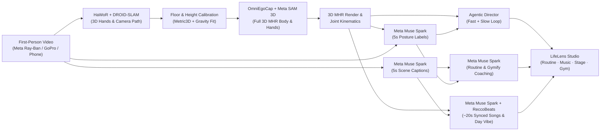

<p align="center">
  <picture>
    <source media="(prefers-color-scheme: dark)" srcset="docs/brand/logo-wordmark-on-dark.svg">
    
  </picture>
</p>

<h3 align="center">One head camera. Your whole body in 3D. Powered by Meta Muse Spark, Meta SAM 3D &amp; Meta MHR.</h3>

<p align="center">
  <a href="https://dev.meta.ai/docs/quickstart"></a>
  <a href="https://ai.meta.com/sam2/"></a>
  <a href="https://github.com/facebookresearch/momentum"></a>
  <a href="https://ai.meta.com/blog/llama-3-2-connect-2024-vision-edge-mobile-devices/"></a>
  <a href="https://github.com/MiroPsota/OmniEgoCap"></a>
  <a href="https://vite.dev/"></a>
  <a href="LICENSE"></a>
</p>

<p align="center">
  <a href="#lifelens-at-a-glance">At a glance</a> ·
  <a href="#demo">Demo</a> ·
  <a href="#what-lifelens-does">Features</a> ·
  <a href="#built-with-meta">Built with Meta</a> ·
  <a href="#how-it-works">How it works</a> ·
  <a href="#links--ecosystem">Links &amp; Ecosystem</a> ·
  <a href="#quick-start">Quick start</a> ·
  <a href="#results">Results</a> ·
  <a href="#what-we-built-during-the-hackathon">What we built</a> ·
  <a href="#team">Team</a>
</p>

---

## LifeLens at a glance

| | |
|---|---|
| **Problem** | Head cameras and smart glasses only see what is in front of you — they never see your own body, so how you move through your day is lost. |
| **Solution** | Rebuild your full articulated **3D body and hands** from a single first-person video using **[Meta SAM 3D](https://ai.meta.com/sam2/)** & **[Meta MHR (Momentum Human Rig)](https://github.com/facebookresearch/momentum)** with [OmniEgoCap](https://github.com/MiroPsota/OmniEgoCap) and [HaWoR](https://github.com/ThunderVVV/HaWoR), then let **[Meta Muse Spark](https://dev.meta.ai/docs/quickstart)** turn how you move into synced music, a virtual dance studio light show, and personal coaching. |
| **Problem statement** | **Push the Frontier:** full-body 3D motion from an egocentric camera that never sees the body is an open frontier in computer vision, wearable AI, and human motion understanding. |
| **Meta AI stack** | **[Meta Muse Spark](https://dev.meta.ai/docs/quickstart)** (`muse-spark-1.3`, Meta Model API) across 9 vision & reasoning stages · **[Meta SAM 3D](https://ai.meta.com/sam2/)** (`SAM 3D Body`) for 3D body perception · **[Meta MHR](https://github.com/facebookresearch/momentum)** (Momentum Human Rig) for articulated 3D body & hand rigging · **[Meta Llama 3.2 3B](https://ai.meta.com/blog/llama-3-2-connect-2024-vision-edge-mobile-devices/)** (open weights via [Ollama](https://ollama.com/library/llama3.2)) as the local offline fallback |
| **Meta hardware** | **[Meta Ray-Ban Smart Glasses](https://www.meta.com/ai-glasses/)** supported natively alongside phone head-mounts and GoPro cameras |
| **Technical depth** | Full-body 3D motion from egocentric video (**Meta SAM 3D** + **Meta MHR** + [HaWoR](https://github.com/ThunderVVV/HaWoR) + [DROID-SLAM](https://github.com/princeton-vl/DROID-SLAM) + [OmniEgoCap](https://github.com/MiroPsota/OmniEgoCap)) · an agentic two-loop show director that plans, verifies, and acts in real time · schema-checked AI responses with retry and fallback |
| **Built this week** | The user-friendly studio web app, the agentic director, all 9 **Meta Muse Spark** integrations, unified video+music sync, Day Vibe & Next-Time song recommendations, Stagify, Gymify, live sessions, DMX/Hue light output, and benchmark evaluation ([what's ours](#what-we-built-during-the-hackathon)) |
| **Proof** | 3D body error **102.6 mm** on 3 OmniEgoDB sequences (vs. **111.7 mm** in the original paper) · **Meta Muse Spark** reply latency cut from **16 s to 8 s** by tuning reasoning effort (`MUSE_REASONING=low`) |
| **Try it** | 4 commands, no GPU needed to explore the included 3D sessions (`eating`, `exercising`, `snowboard-strap-in`) ([Quick start](#quick-start)) |

## Why LifeLens

Smart glasses like **[Meta Ray-Ban Glasses](https://www.meta.com/ai-glasses/)** and head-mounted action cameras are becoming everyday devices, but they only see what is **in front** of you. They never see your own body: how you walk, sit, bend, train, or perform.

**LifeLens brings your movement to life.** From a single first-person clip, it reconstructs your **full 3D body and hands** on the **[Meta Momentum Human Rig (MHR)](https://github.com/facebookresearch/momentum)** powered by **[Meta SAM 3D](https://ai.meta.com/sam2/)**. Then **[Meta Muse Spark](https://dev.meta.ai/docs/quickstart)** turns your movement into four everyday experiences:

- 🧭 **Routine & Habit Coach** — sees both your first-person view and your 3D MHR body to summarize your posture, highlight key moments on an interactive timeline, and suggest friendly habit adjustments.
- 🎵 **Unified Video & Music Player + Day Vibe** — plays your video and Spotify soundtrack in lockstep (1 matched track for 20–30 s clips, or 1 track per ~20 s movement window for longer clips, plus a quirky AI DJ warm-up notice for clips under 10 s), and recommends **Your Day Vibe in a Song** plus tracks to **Play Next Time You're Doing Similar Tasks**.
- 💡 **Virtual Dance Studio & Stage Show** — places your 3D body under six reactive stage lights that follow your arms, legs, torso, and pace while **Meta Muse Spark** designs lighting scenes.
- 🏋️ **Gymify Workout Coach** — recognizes your exercise with **Meta Muse Spark**, counts reps, depth, tempo, and left-right balance on your 3D MHR joints, and gives visual per-rep coaching cards.

## Demo

[](docs/lifelens-demo.mp4)

The included sessions in [`examples/`](examples) (`eating`, `exercising`, and `snowboard-strap-in`) contain our own head-mounted GoPro clips together with their reconstructed **3D MHR body meshes**, joint kinematics, synced Spotify soundtracks, and **Meta Muse Spark** outputs.

## What LifeLens does

| | Tab | What you get |
|---|---|---|
| 🧭 | **Routine** | Your camera view, **3D MHR body**, and movement flow side by side; **Current Moment** showing the exact 3D body & POV frames **Meta Muse Spark** inspected; posture breakdown donut, clickable photo timeline, comparisons across **Past Sessions**, and visual **Coaching & Habit Tips**. |
| 🎵 | **Music** | **Unified Video & Music Player**: pressing Play starts the video and its matched [Spotify](https://developer.spotify.com/documentation/embeds) track in lockstep. Clips of 20–30 s lock **1 best-fitting song**; longer clips switch songs automatically every **~20 s movement window**; clips under 10 s show an illustrated AI DJ warm-up card. Includes **Your Day Vibe in a Song** and **Play Next Time You're Doing Similar Tasks** recommendations. |
| 💡 | **Stage** | Your 3D MHR body performs center stage under 6 fixtures (left/right arm, left/right leg, torso, pace) with scenes designed by **Meta Muse Spark**. **Create full stage show (Stagify)** plans a complete show and exports DMX ([Art-Net](https://art-net.org.uk/)) / [Philips Hue](https://developers.meethue.com/) lighting cues. |
| 🏋️ | **Gym** | **Workout Coach (Gymify):** **Meta Muse Spark** identifies the exercise from 3D body and POV frames, while LifeLens measures reps, sets, depth range, down/up tempo, and left-right balance on the 3D MHR joints, paired with clickable per-rep visual coaching cards. |
| 🔴 | **Record live** | Film from your camera while **Meta Muse Spark** captions what you are doing and names your posture every few seconds, then process the clip into your full 3D MHR body, soundtrack, and stage show. |

On a cozy, non-workout recording (such as `eating`), **Meta Muse Spark** detects that it is an everyday moment and displays custom illustrated rest-day / cozy-break cards in the Stage and Gym tabs instead of forcing a light show or rep count.

## Built with Meta

LifeLens is built around **Meta's AI and 3D human foundation stack**:

| Meta technology | Version / Repo | How LifeLens uses it |
|---|---|---|
| **[Meta Muse Spark](https://dev.meta.ai/docs/quickstart)** | `muse-spark-1.3` ([Meta Model API](https://dev.meta.ai/docs/quickstart), `https://api.meta.ai/v1/responses`) | **The multimodal brain of LifeLens (9 integrations):** reads first-person camera frames and 3D MHR body renders to produce scene narrations, 5 s posture labels, routine habit tips, workout exercise recognition, per-rep form coaching, ~20 s music styles & activity classification, live camera captions, and real-time stage lighting scenes. |
| **[Meta SAM 3D](https://ai.meta.com/sam2/)** | `SAM 3D Body` ([Meta Segment Anything](https://ai.meta.com/sam2/)) | **3D human body perception & segmentation foundation:** anchors visual body/hand understanding and 3D human mesh recovery from challenging first-person and monocular views. |
| **[Meta MHR (Momentum Human Rig)](https://github.com/facebookresearch/momentum)** | [facebookresearch/momentum](https://github.com/facebookresearch/momentum) | **Articulated 3D body & hand representation:** parameterizes the full-body skeletal joints, body mesh, and articulated 15-joint hands rendered in `mesh_exo.mp4` and analyzed for joint angles, pace, and rep depth. |
| **[Meta Llama 3.2](https://ai.meta.com/blog/llama-3-2-connect-2024-vision-edge-mobile-devices/)** | `llama3.2:3b` ([Open Weights via Ollama](https://ollama.com/library/llama3.2)) | **Local open-weights fallback:** runs locally on-device when offline or when `MODEL_PROVIDER=ollama` is selected in `director/.env`. |
| **[Meta Ray-Ban Smart Glasses](https://www.meta.com/ai-glasses/)** | `--camera glasses` preset | **Wearable first-person capture:** dedicated optical preset (FOV, head-mount offset, and lens profile) for clips recorded hands-free on Meta Ray-Ban Glasses. |

### Where Meta Muse Spark powers LifeLens (9 stages)

| Stage | Input to Meta Muse Spark | What Meta Muse Spark outputs |
|---|---|---|
| **1. Scene narration** ([`describe_muse.py`](pipeline/describe_muse.py)) | 3 POV frames per 5 s window | Concise description of what you are doing every 5 seconds |
| **2. 3D posture classification** ([`posture_muse.py`](director/posture_muse.py)) | 1 3D MHR body frame + 1 POV frame every 5 s | Labels your posture (`walking`, `standing`, `sitting`, `crouching`, `bending`, `arms raised`) |
| **3. Routine coaching** ([`routine_tips.py`](director/routine_tips.py)) | Posture log, captions, session stats + 8 3D MHR body frames | Session takeaway, timestamped habit adjustments, and cross-session comparison |
| **4. Live camera captions** ([`vite.config.js`](vite.config.js)) | 2 live camera frames, 1 s apart | Real-time activity caption and posture label while recording |
| **5. Show director mood** ([`director/server.py`](director/server.py)) | Plain-text movement summary every ~6 s | Target mood, energy, light action, and tempo |
| **6. Stage lighting designer** ([`vite.config.js`](vite.config.js)) | Live 3D MHR body frame + movement summary + active song | 6-fixture lighting scene (palette, beat pattern, body-part focus, strobe) |
| **7. Stagify show planner** ([`stagify.js`](src/stagify.js)) | 3D MHR body frames + per-10 s movement summaries | Complete multi-scene lighting plan and soundtrack arc |
| **8. Gymify workout coach** ([`gymify.py`](pipeline/gymify.py)) | 3D MHR body frames + POV frames + per-rep joint metrics | Exercise identification, confidence, per-rep form cues, and workout music profile |
| **9. Movement-synced music DJ** ([`songs.py`](pipeline/songs.py)) | Captions + ~20 s movement metrics | Names the overall activity, whether it is an active workout/dance, and the musical style & mood for each ~20 s window |

### How we use Meta's models well

- **Schema-checked answers with retry and fallback.** Every **Meta Muse Spark** and **Meta Llama 3.2** response is validated against a strict JSON schema, retried on invalid output, and backed by deterministic kinematic rules if a call times out.
- **Tuned reasoning effort (`MUSE_REASONING=low`).** Benchmarking `muse-spark-1.3` across reasoning levels showed that `low` cuts response latency from **~16 s to ~8 s** with equally accurate structured outputs across 40 test calls.
- **API keys stay server-side.** All **Meta Muse Spark** calls go through the local server (`director/.env` is gitignored); the browser never sees your API key.

## How it works



1. **Ingest:** [FFmpeg](https://ffmpeg.org/) normalizes the input clip to 30 fps (up to 1920 px wide) and applies the camera preset's lens correction (`glasses`, `gopro-wide`, `gopro-linear`, or `phone`).
2. **3D hands & camera trajectory** ([`hawor_export.py`](pipeline/hawor_export.py)): [HaWoR](https://github.com/ThunderVVV/HaWoR) reconstructs the 3D wrists and 15 finger joints per hand in world space, while [DROID-SLAM](https://github.com/princeton-vl/DROID-SLAM) tracks the 6-DoF head-camera trajectory across overlapping 30 s windows.
3. **Floor fit & metric scale** ([`build_input.py`](pipeline/build_input.py)): fits a ground plane to the SLAM point cloud to align gravity and scales the world using your height (or [Metric3D v2](https://github.com/YvanYin/Metric3D) depth when height is omitted).
4. **Full-body 3D reconstruction** ([`run_omniegocap.py`](pipeline/run_omniegocap.py)): [OmniEgoCap](https://github.com/MiroPsota/OmniEgoCap) together with **[Meta SAM 3D](https://ai.meta.com/sam2/)** and the **[Meta Momentum Human Rig (MHR)](https://github.com/facebookresearch/momentum)** infers the 22-joint 3D body from head and wrist motion and fuses the articulated 3D hand poses.
5. **Render & kinematics** ([`render.py`](pipeline/render.py)): renders the third-person **3D MHR body mesh** (`mesh_exo.mp4`), scrolling joint-angle & speed plot (`pose_graph.mp4`), and side-by-side comparison (`side_by_side.mp4`).
6. **Meta Muse Spark narration, posture, coaching & music** ([`describe_muse.py`](pipeline/describe_muse.py), [`posture_muse.py`](director/posture_muse.py), [`routine_tips.py`](director/routine_tips.py), [`songs.py`](pipeline/songs.py), [`gymify.py`](pipeline/gymify.py)): labels every 5 s window, matches 1 song per ~20 s window via [ReccoBeats](https://reccobeats.com/) & [Spotify](https://developer.spotify.com/documentation/embeds), and generates visual routine & workout coaching.

## Links & Ecosystem

Every model, library, API, and hardware integration used in LifeLens:

### Meta AI Models, Rigs & Hardware
- **[Meta Muse Spark (`muse-spark-1.3`)](https://dev.meta.ai/docs/quickstart)** — Multimodal vision-language reasoning via the [Meta Developer API (`https://api.meta.ai/v1/responses`)](https://dev.meta.ai/docs/quickstart)
- **[Meta SAM 3D (`SAM 3D Body`)](https://ai.meta.com/sam2/)** — Meta Segment Anything foundation for visual perception and 3D human body reconstruction
- **[Meta MHR (Momentum Human Rig)](https://github.com/facebookresearch/momentum)** — Meta's open-source articulated 3D human body and hand rig ([`facebookresearch/momentum`](https://github.com/facebookresearch/momentum))
- **[Meta Llama 3.2 (`llama3.2:3b`)](https://ai.meta.com/blog/llama-3-2-connect-2024-vision-edge-mobile-devices/)** — Open-weights local language model run via [Ollama (`ollama.com/library/llama3.2`)](https://ollama.com/library/llama3.2)
- **[Meta Ray-Ban Smart Glasses](https://www.meta.com/ai-glasses/)** — Wearable first-person camera supported via the `glasses` optical preset

### 3D Vision, SLAM & Motion Pipeline
- **[OmniEgoCap](https://github.com/MiroPsota/OmniEgoCap)** — Egocentric full-body 3D motion capture from head and hand signals ([arXiv:2512.01290](https://arxiv.org/abs/2512.01290))
- **[HaWoR](https://github.com/ThunderVVV/HaWoR)** — World-space 3D hand and wrist motion reconstruction from egocentric video ([arXiv:2501.02973](https://arxiv.org/abs/2501.02973))
- **[DROID-SLAM](https://github.com/princeton-vl/DROID-SLAM)** — Deep visual SLAM for camera trajectory and floor-plane point clouds ([arXiv:2108.10869](https://arxiv.org/abs/2108.10869))
- **[Metric3D v2](https://github.com/YvanYin/Metric3D)** — Monocular metric depth & surface normal estimation for floor calibration ([arXiv:2404.15506](https://arxiv.org/abs/2404.15506))

### Music, Lighting & Web Stack
- **[ReccoBeats API](https://reccobeats.com/)** — Audio-feature track recommendations (`energy`, `tempo`, `danceability`, `valence`, `acousticness`)
- **[Spotify Embed / IFrame API](https://developer.spotify.com/documentation/embeds)** — Synced in-app music playback
- **[Vite 6](https://vite.dev/)** & **[Node.js](https://nodejs.org/)** — Studio web application and local API server
- **[FFmpeg](https://ffmpeg.org/)** — Video normalization, lens correction, and stream encoding
- **[Art-Net DMX](https://art-net.org.uk/)** & **[Philips Hue Developer API](https://developers.meethue.com/)** — Real-world stage lighting output

## Quick start

The studio app opens the included processed 3D sessions (`eating`, `exercising`, `snowboard-strap-in`) immediately **without needing a GPU**. Processing a brand-new video uses the 3D pipeline on an NVIDIA GPU ([Process your own video](docs/DEEP_DIVE.md#process-your-own-video)).

You need [Node.js](https://nodejs.org/) 18+, [Python](https://www.python.org/) 3.10+, and a [Meta Muse Spark API key](https://dev.meta.ai/docs/quickstart).

```sh
git clone https://github.com/nshreyasvi/LifeLens.git && cd LifeLens
npm install
python -m venv director/venv
director/venv/bin/pip install -r director/requirements.txt     # Windows: director\venv\Scripts\pip
cp director/.env.example director/.env                          # then set MUSE_API_KEY=...
DIRECTOR_PYTHON=director/venv/bin/python npm run dev            # open http://localhost:8000
```

Add `MUSE_REASONING=low` to `director/.env` for fast ~8 s **Meta Muse Spark** replies. Without a key, you can set `MODEL_PROVIDER=ollama` in `director/.env` to use **[Meta Llama 3.2](https://ollama.com/library/llama3.2)** locally.

## Results

Measured on an NVIDIA RTX 4060 Laptop GPU (8 GB VRAM).

**3D body accuracy vs. OmniEgoDB motion capture** (13,737 frames):

| Metric | office | outdoor | robothome | All three | Paper (20 seq.) |
|---|---|---|---|---|---|
| MPJPE (mm) | 93.9 | 101.7 | 105.6 | **102.6** | 111.7 |
| Hand error (mm) | 159.0 | 110.0 | 135.0 | **134.0** | 166.2 |
| Jerk (km/s³) | 0.02 | 0.03 | 0.01 | **0.016** | 0.073 |

**Pipeline runtime** ([`bench/live_fps.py`](bench/live_fps.py), per 1 second of 30 fps video):

| Stage | Seconds per video second |
|---|---|
| HaWoR 3D hands + DROID-SLAM | 30–77 s (78–85% of total) |
| OmniEgoCap + Meta SAM 3D / MHR | 2.2–3.5 s |
| 3D MHR Render & kinematics | 2.2–3.9 s |
| Meta Muse Spark captions (1 call / 5 s) | 3.4–3.7 s |
| Director fast loop | 0.06 ms per frame |

## What we built during the hackathon

Everything in this repository was built by our team between **Oct 26 and Nov 4, 2026**:

| ✅ Built by us this week | 📦 Foundation models & APIs we build on |
|---|---|
| Complete LifeLens studio app: Start screen, Routine, Unified Music Player + Day Vibe & Next-Time Picks, Dance Studio Stage, Gymify, and Live recording | **[Meta Muse Spark (`muse-spark-1.3`)](https://dev.meta.ai/docs/quickstart)** and **[Meta Llama 3.2](https://ollama.com/library/llama3.2)** |
| Agentic two-loop show director: fast kinematic loop, slow **Meta Muse Spark** planning loop, freeze detection, reactive strobes | **[Meta SAM 3D](https://ai.meta.com/sam2/)** & **[Meta MHR (Momentum Human Rig)](https://github.com/facebookresearch/momentum)** |
| All 9 **Meta Muse Spark** vision & reasoning integrations and verified JSON schemas | **[OmniEgoCap](https://github.com/MiroPsota/OmniEgoCap)**, **[HaWoR](https://github.com/ThunderVVV/HaWoR)**, **[DROID-SLAM](https://github.com/princeton-vl/DROID-SLAM)** & **[Metric3D v2](https://github.com/YvanYin/Metric3D)** |
| End-to-end orchestration (`pipeline/`): camera presets (`glasses`, `gopro-wide`, `gopro-linear`, `phone`), height calibration, floor fit, 3D MHR rendering, ~20 s window song sync | **[ReccoBeats API](https://reccobeats.com/)** & **[Spotify IFrame API](https://developer.spotify.com/documentation/embeds)** |
| Stagify, Gymify, body-rhythm autocorrelation, DMX ([Art-Net](https://art-net.org.uk/)) & [Philips Hue](https://developers.meethue.com/) hardware output, and our own GoPro example sessions (`eating`, `exercising`, `snowboard-strap-in`) | **OmniEgoDB** (used for benchmark evaluation only) |

Full technical documentation on calibration, processing, and every output file: [`docs/DEEP_DIVE.md`](docs/DEEP_DIVE.md).

## Team

Built for the **Meta Global AI Developer Hackathon 2026**.

| Member | Role |
|---|---|
| **Shrey** ([@nshreyasvi](https://github.com/nshreyasvi)) | Lead · 3D pipeline (Meta SAM 3D, MHR, HaWoR, OmniEgoCap) · Meta Muse Spark integrations · Studio UI & design |
| **Dhruv** ([@Dhruv-Patil-1720](https://github.com/Dhruv-Patil-1720)) | Agentic Director (StageSense): fast & slow loops, freeze detection, reactive flash, Muse Spark reasoning tuning |
| **Avi** ([@avinashmantripragada](https://github.com/avinashmantripragada)) | Front-end architecture: Vite app, live director sync, stage lights & music (ReccoBeats + Spotify), routine view, light/dark theme |
| **Yash** | Research, testing on real recordings, demo & submission support |

## License

**LifeLens is 100% open source under the [MIT License](LICENSE)** — there are no non-commercial restrictions on this repository, its application code, the agentic director, the pipeline scripts, or our own example recordings and outputs in [`examples/`](examples). No third-party model weights or gated datasets are bundled in this repository.

**Built with:** [Meta Muse Spark](https://dev.meta.ai/docs/quickstart) · [Meta SAM 3D](https://ai.meta.com/sam2/) · [Meta MHR (Momentum Human Rig)](https://github.com/facebookresearch/momentum) · [Meta Llama 3.2](https://ollama.com/library/llama3.2) · [Meta Ray-Ban Glasses](https://www.meta.com/ai-glasses/) · [OmniEgoCap](https://github.com/MiroPsota/OmniEgoCap) · [HaWoR](https://github.com/ThunderVVV/HaWoR) · [DROID-SLAM](https://github.com/princeton-vl/DROID-SLAM) · [ReccoBeats](https://reccobeats.com/) · [Spotify](https://developer.spotify.com/documentation/embeds).

<p align="center">© 2026 LifeLens team</p>
