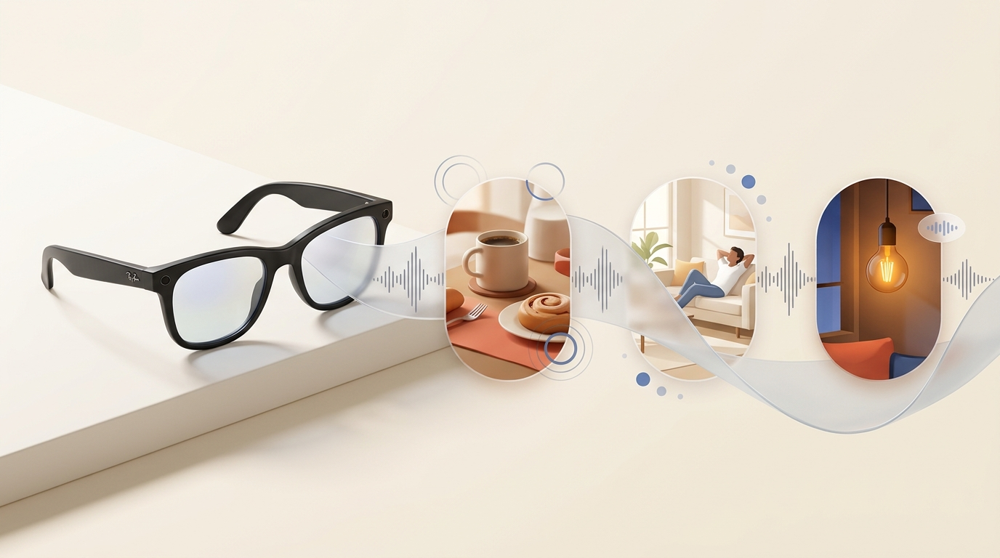
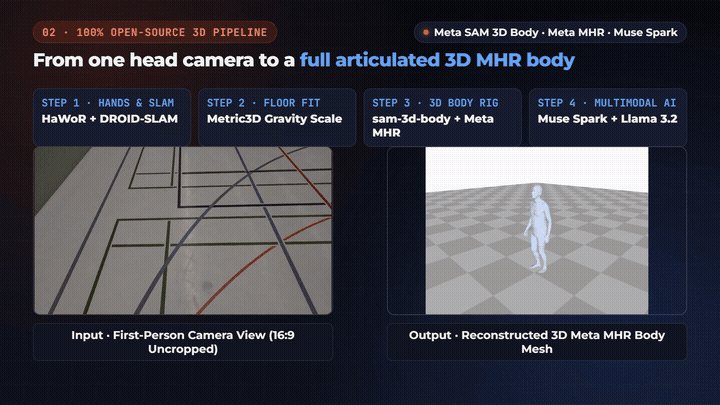
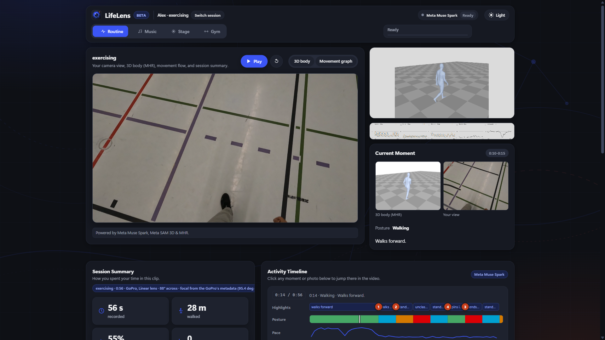
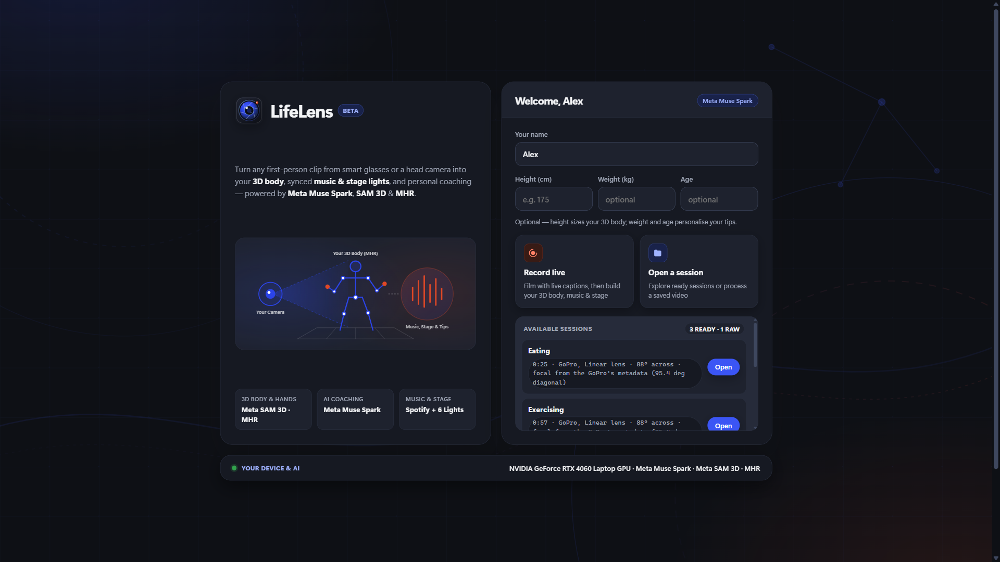
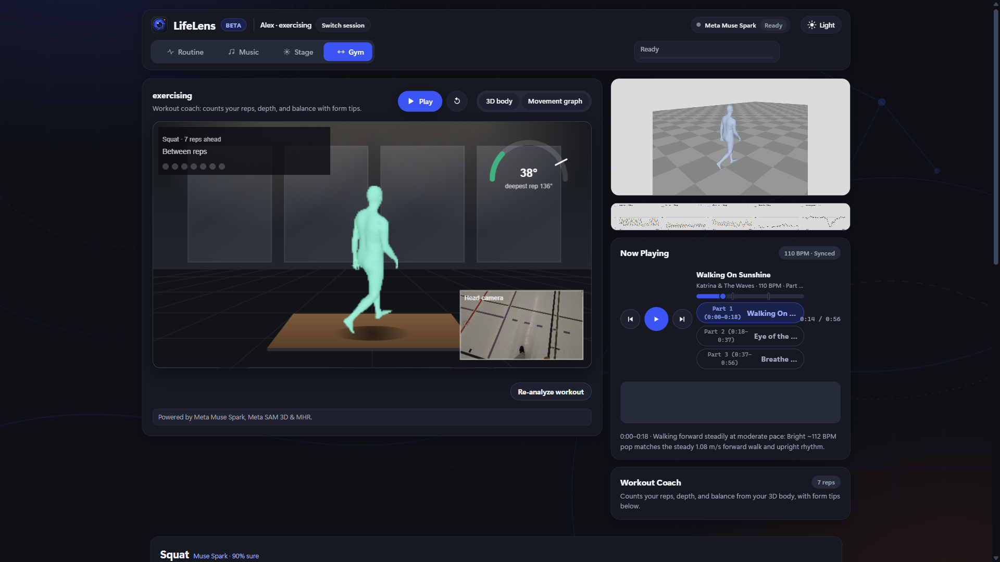
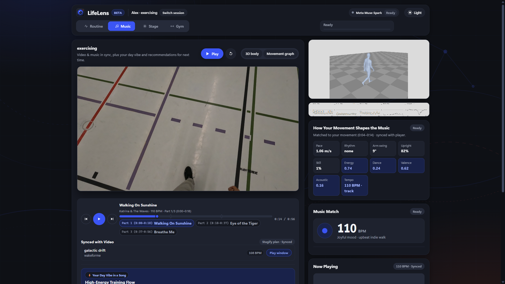
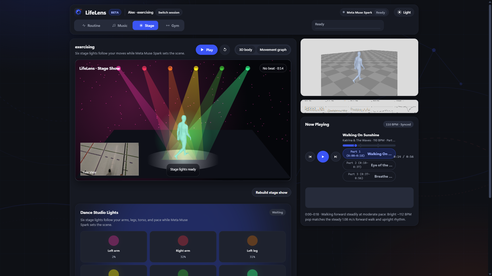

<p align="center">
  
</p>

<p align="center">
  <picture>
    <source media="(prefers-color-scheme: dark)" srcset="docs/brand/logo-wordmark-on-dark.svg">
    
  </picture>
</p>

<h3 align="center">
  One Head Camera. Your Whole Body in 3D.<br/>
  <sub>Powered by <b>Meta Muse Spark 1.3</b>, <b>Meta MHR (Momentum Human Rig)</b>, <b>Meta Llama 3.2</b> &amp; <b>ReccoBeats</b></sub>
</h3>

<p align="center">
  <a href="https://dev.meta.ai/docs/quickstart"></a>
  <a href="https://github.com/facebookresearch/momentum"></a>
  <a href="https://ollama.com/library/llama3.2"></a>
  <a href="https://www.meta.com/ai-glasses/"></a>
  <a href="https://github.com/MiroPsota/OmniEgoCap"></a>
  <a href="https://reccobeats.com/"></a>
  <a href="https://vite.dev/"></a>
  <a href="LICENSE"></a>
</p>

<p align="center">
  <a href="#why-lifelens">Overview</a> ·
  <a href="#video-demo">Video Demo</a> ·
  <a href="#use-cases-powered-by-meta-mhr--meta-muse-spark">Use Cases</a> ·
  <a href="#ui-tour">UI Screenshots</a> ·
  <a href="#3d-pipeline-architecture">Architecture</a> ·
  <a href="#installation--quick-start">Quick Start</a> ·
  <a href="#documentation-hub">Docs Hub</a> ·
  <a href="#open-source-license">License</a>
</p>

---

## Why LifeLens

Head-mounted cameras and smart glasses like **[Meta Ray-Ban Glasses](https://www.meta.com/ai-glasses/)** only see what is **in front** of you — they never see your own body.

**LifeLens reconstructs how your whole body moves from a single first-person camera.** Tested on head-mounted GoPro recordings and designed for Meta Ray-Ban Smart Glasses and phone head-mounts, LifeLens uses **[Meta MHR (Momentum Human Rig)](https://github.com/facebookresearch/momentum)** together with [HaWoR](https://github.com/ThunderVVV/HaWoR), [DROID-SLAM](https://github.com/princeton-vl/DROID-SLAM), [Metric3D v2](https://github.com/YvanYin/Metric3D), and [OmniEgoCap](https://github.com/MiroPsota/OmniEgoCap) to recover your **22-joint 3D body and 30-joint articulated hands** in world space. Then **[Meta Muse Spark 1.3](https://dev.meta.ai/docs/quickstart)** (with **[Meta Llama 3.2](https://ollama.com/library/llama3.2)** for offline local mode) and open-source **[ReccoBeats](https://reccobeats.com/)** turn your 3D motion into daily habit coaching, visual workout rep analysis, movement-synced music with **Day Vibe** picks, and a 6-light virtual stage show.

---

## Video Demo

<p align="center">
  <a href="docs/lifelens-demo.mp4">
    
  </a>
  <br/>
  <sub>🎬 Click the preview above to watch <a href="docs/lifelens-demo.mp4"><b>docs/lifelens-demo.mp4</b></a> (full HD walkthrough with voiceover).</sub>
</p>

---

## Use Cases Powered by Meta MHR & Meta Muse Spark

| Experience | How Meta MHR + Meta Muse Spark + ReccoBeats Work Together |
|---|---|
| 🧭 **Routine & Habit Coach** | Reconstructs your full **3D Meta MHR body** (`mesh_exo.mp4`) and live joint kinematics (`pose_graph.mp4`) from everyday clips (meals, desk work, walks, outdoor sports) while **Meta Muse Spark** inspects both POV and 3D MHR frames to label posture every 5 seconds and give friendly habit coaching. |
| 🏋️ **Gymify Workout Coach** | Tracks knee flexion, hip hinge, elbow angles, and left–right balance directly on the **3D MHR joints** while **Meta Muse Spark** identifies the exercise from 3D MHR renders, counts reps & sets, and provides visual per-rep depth gauges and form cues. |
| 🎵 **Synced Music + Day Vibe** | Uses open-source **[ReccoBeats](https://reccobeats.com/)** audio feature matching to lock your video and music player in sync (1 track for 20–30 s clips, or 1 track per ~20 s movement window for longer clips) and curates **Your Day Vibe in a Song** plus tracks to **Play Next Time You're Doing Similar Tasks**. |
| 💡 **Virtual Dance Studio Stage** | Places your **3D MHR body** center stage under 6 reactive lighting fixtures mapped to your left/right arms, legs, torso, and pace, with full-show choreography (**Stagify**) and real-world [Art-Net DMX](https://art-net.org.uk/) & [Philips Hue](https://developers.meethue.com/) export. |

---

## UI Tour

> Full walkthrough of every view and control: **[`docs/UI_GUIDE.md`](docs/UI_GUIDE.md)**

<p align="center">
  
  <br/>
  <sub><b>Routine &amp; Habit Coach:</b> Synchronized first-person POV, 3D Meta MHR body mesh, live joint kinematics stream below the mesh, clickable 5s photo timeline, and friendly habit tips.</sub>
</p>

| Start Screen & Session Launcher | Gymify Visual Workout Coach |
|---|---|
|  |  |
| Pick a pre-processed 3D session (`eating`, `exercising`, `snowboard-strap-in`, `activities`), process a new recording, or film live with hardware telemetry. | Automatic exercise recognition, 3D MHR squat depth & symmetry bars, and clickable per-rep coaching cards. |

| Unified Music Player & Day Vibe | 6-Fixture Virtual Stage Show |
|---|---|
|  |  |
| Video and open-source ReccoBeats music player locked in sync across ~20 s movement windows, plus **Day Vibe** and **Play Next Time** recommendations. | 6 virtual stage lights driven by your 3D MHR limb velocities with persistent POV inset and DMX / Hue output. |

---

## 3D Pipeline Architecture

<p align="center">
  <picture>
    <source media="(prefers-color-scheme: dark)" srcset="docs/architecture-pipeline-dark.svg">
    
  </picture>
</p>

---

## Installation & Quick Start

You can explore all included 3D MHR sessions (`eating`, `exercising`, `snowboard-strap-in`, `activities`) **immediately on any laptop — no GPU required**.

### 1. Clone & Install

```bash
git clone https://github.com/nshreyasvi/LifeLens.git
cd LifeLens
npm install

# Set up the Python environment for the live director & Meta Muse Spark
python -m venv director/venv
director/venv/bin/pip install -r director/requirements.txt   # Windows: director\venv\Scripts\pip install -r director/requirements.txt
```

### 2. Configure Meta Muse Spark (or Local Meta Llama 3.2)

```bash
cp director/.env.example director/.env
```

Add your [Meta Muse Spark API key](https://dev.meta.ai/docs/quickstart) to `director/.env` (or set `MODEL_PROVIDER=ollama` to run **[Meta Llama 3.2](https://ollama.com/library/llama3.2)** locally offline):

```ini
MUSE_API_KEY=your_meta_api_key_here
MUSE_MODEL=muse-spark-1.3
MUSE_REASONING=low
```

### 3. Launch LifeLens Studio

```bash
npm run dev
```

Open **`http://localhost:8000`** in your browser.

> **Want to run the 3D GPU pipeline on your own videos?** See **[`docs/USAGE_AND_PIPELINE.md`](docs/USAGE_AND_PIPELINE.md)** for one-command WSL2 / Linux CUDA setup (`bash archive/scripts/setup.sh`) and camera presets (`glasses`, `phone`, `gopro-linear`, `gopro-wide`).

---

## Included 3D Sessions (`examples/` & `runs/`)

| Session | Activity | Duration | Highlights |
|---|---|---|---|
| **`eating`** | Seated Meal & Hand Gestures | 27 s | High-visibility 3D hand & wrist reconstruction (`HaWoR` + `Meta MHR`), seated posture coaching, cozy rest-day cards |
| **`exercising`** | Full-Body Bodyweight Squats | 35 s | **Gymify** automatic squat detection, `136°` peak knee flexion tracking, per-rep depth & balance coaching |
| **`snowboard-strap-in`** | Ground-Level Snowboard Binding Strap-In | 35 s | Deep ground crouch & forward reach reconstruction (`Meta MHR` + `OmniEgoCap`), outdoor mountain kinematics |
| **`activities`** | Multi-Activity Daily Routine | 48 s | Continuous transition across everyday postures, ~20 s window ReccoBeats music transitions, and **Day Vibe** picks |

---

## Documentation Hub

Detailed guides and technical references live in [`docs/`](docs):

| Guide | What It Covers |
|---|---|
| 🖥️ **[UI & Features Guide (`docs/UI_GUIDE.md`)](docs/UI_GUIDE.md)** | Visual walkthrough of the **Start Screen**, **Routine & Habit Coach**, **Gymify Workout Coach**, **Unified Music Player + Day Vibe**, and **Virtual Stage Show**. |
| ⚙️ **[Usage & 3D Pipeline Guide (`docs/USAGE_AND_PIPELINE.md`)](docs/USAGE_AND_PIPELINE.md)** | Step-by-step installation, camera calibration presets (**Meta Ray-Ban Glasses**, GoPro, Phone), running `pipeline/run.py`, and hardware DMX / Hue lighting. |
| 🧠 **[Meta AI Models & Ecosystem (`docs/MODELS_AND_ECOSYSTEM.md`)](docs/MODELS_AND_ECOSYSTEM.md)** | How **Meta MHR**, **Meta Muse Spark 1.3** (all 9 stages), **Meta Llama 3.2**, and open-source **ReccoBeats** work together, plus 3D MPJPE accuracy benchmarks (`102.6 mm`) and full ecosystem links. |
| 🔬 **[Technical Deep Dive (`docs/DEEP_DIVE.md`)](docs/DEEP_DIVE.md)** | Calibration math, joint kinematics formulas, body-rhythm autocorrelation, and every output file schema. |

---

## Team

Built for the **Meta Global AI Developer Hackathon 2026**.

| Member | Role |
|---|---|
| **Shrey** ([@nshreyasvi](https://github.com/nshreyasvi)) | Lead · 3D pipeline (Meta MHR, HaWoR, OmniEgoCap) · Meta Muse Spark integrations · Studio UI & design |
| **Dhruv** ([@Dhruv-Patil-1720](https://github.com/Dhruv-Patil-1720)) | Agentic Director: fast & slow loops, freeze detection, reactive flash, Muse Spark reasoning tuning |
| **Avi** ([@avinashmantripragada](https://github.com/avinashmantripragada)) | Front-end architecture: Vite app, live director sync, stage lights & music (ReccoBeats), routine view |
| **Yash** | Research, testing on real recordings, demo & submission support |

---

## Open Source License

**LifeLens is 100% open source under the [MIT License](LICENSE)** — there are **no non-commercial restrictions** on this repository, its studio application, the agentic director, the pipeline scripts, or our included example recordings and 3D MHR outputs in [`examples/`](examples). No restricted third-party weights or gated datasets are bundled in this repository.
