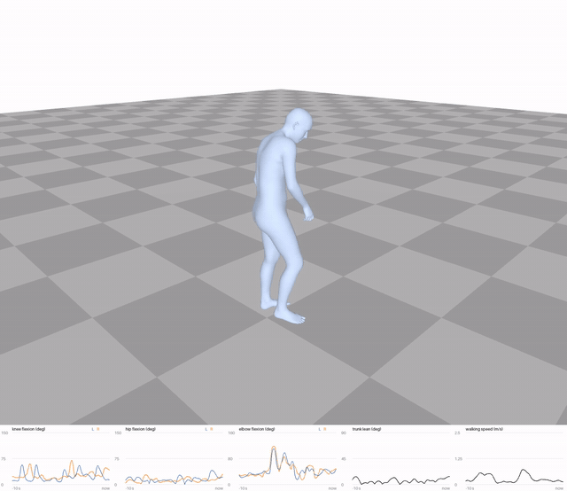
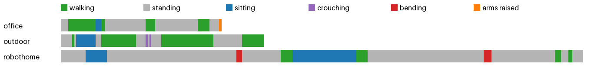
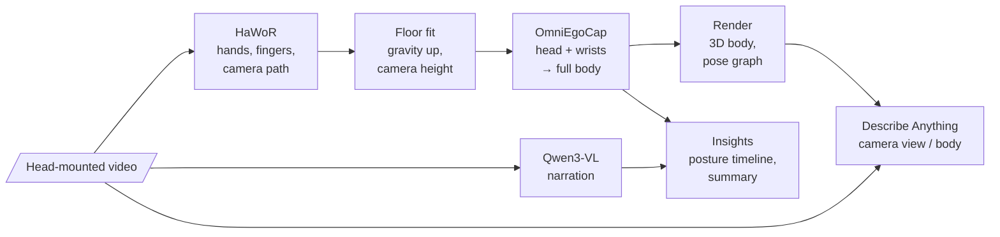

# LifeLens

A head-mounted **phone or GoPro** video goes in. The wearer's whole body comes out in 3D, although the camera never
sees it, together with what they do and how they move over the day.



*The `robothome` demo, 11–26 s: the wearer sits down on a chair and gets up. Body reconstructed from the head camera
alone. Graph underneath, left to right: knee, hip and elbow flexion (left / right), trunk lean, walking speed.
Full videos: [`examples/*/mesh_exo.mp4`](examples). The camera half of the side-by-side video is left out: the
dataset's footage can't be redistributed.*

| Output | What it is |
|---|---|
| **3D motion** | SMPL-H body with fingers, 30 fps, as `.npy` / `.csv` / AMASS `.npz` |
| **Side-by-side video** | camera \| 3D body, live pose graph underneath |
| **Descriptions** | every 5 s: Qwen3-VL-2B narrates the activity; optionally Describe Anything describes a region |
| **Activity insights** | posture per second, time split, breaks, a short summary with suggestions (below) |



*Posture per second over the three demos ([`examples/day/insights.md`](examples/day/insights.md)), from fixed
thresholds on the reconstructed body. It matches the posture in the motion capture in 96% of 5 s windows (measured
on these same clips, which the sitting rule was tuned on).*

**Try it without installing:** [`examples/`](examples) holds the outputs of the three demos (`office`, `outdoor`,
`robothome`, and `day`, a report over all three), also as zips in
[Releases → demos-v1](https://github.com/nshreyasvi/LifeLens/releases/tag/demos-v1).

## How it works



[HaWoR](https://github.com/ThunderVVV/HaWoR) finds the hands and the camera's path in the video. Only the head (the
camera) and the wrists are tracked. [OmniEgoCap](https://github.com/KyungWonCho/OmniEgoCap) infers a full body
that fits them. The legs are therefore a plausible guess, not an observation.

## 1. Set up (Linux or WSL2, NVIDIA GPU with 8 GB, CUDA 12.6)

```bash
bash setup.sh          # conda envs omniegocap, hawor, mhr, vlm: pinned upstream commits, weights, HaWoR patch
bash setup.sh dam      # optional: Describe Anything + SAM 2.1 (NVIDIA non-commercial license)
```

Then add the licensed body models (free registration at https://mano.is.tue.mpg.de):

| Download | Put it at |
|---|---|
| SMPL-H "Extended SMPL+H model" `smplh.tar.xz` | `tar -xJf smplh.tar.xz -O neutral/model.npz > third_party/OmniEgoCap/data/smplh/SMPLH_NEUTRAL.npz` |
| MANO `mano_v1_2.zip`: `models/MANO_RIGHT.pkl` | `third_party/HaWoR/_DATA/data/mano/` |
| MANO `mano_v1_2.zip`: `models/MANO_LEFT.pkl` | `third_party/HaWoR/_DATA/data_left/mano_left/` |

Check the install: `conda activate omniegocap && python bench/smoke_test.py` (a synthetic walk through every stage).

## 2. Run

```bash
conda activate omniegocap
python pipeline/run.py my_walk.mov my_walk                    # → runs/my_walk/
```

| Flag | Meaning |
|---|---|
| `--focal F` | focal length in pixels of the ≤1920 px working video. If omitted, read from an iPhone video's lens metadata (tested on synthetic files only so far) |
| `--describe qwen dam` | description model(s): `qwen` (default, activity narration, ~1 s per 5 s of video), `dam` (Describe Anything on the camera view, the body and both, ~2 min per 5 s), `none`. Compared under [Which description model?](#which-description-model) |
| `--smooth S` | body smoothing in frames (default 2); `0` = OmniEgoCap's raw output, as in the paper |
| `--input_npz F` | a ready OmniEgoCap input (e.g. OmniEgoDB's `input.npz`): no SLAM, HaWoR only for the fingers |
| `--opt` | OmniEgoCap's wrist optimization: same body error, 71% more jerk, 2–3× slower (paper, Table 3) |

Each stage is skipped when its output exists; delete the file to redo it. A day of clips gets one report:
`python pipeline/insights.py runs/morning runs/lunch runs/afternoon --out runs/day`.

## 3. Record your own video

* The camera must be **rigid with the head** (head strap or cap mount); chest or handheld footage won't work.
* Landscape, 1× or 0.5× lens, 30 or 60 fps. GoPro: Linear lens, HyperSmooth and Horizon Leveling off.
* Tilt it 20–30° down so the hands are in view, and keep some floor in view.
* Stand still and look ahead for the first 3 s.
* **Focal length** matters most: a wrong one makes SLAM fail and the body drift. Recent iPhones store it in the video,
  and the pipeline reads it (check the `== focal:` line it prints). For other
  cameras pass `--focal 960/tan(hfov/2)` for a lens with horizontal field of view `hfov` (1920 px working width).
* Keep clips under 2 min (OmniEgoCap slows down sharply beyond that); record several for a day.

## 4. Replicate the demos and the accuracy numbers

The demos are OmniEgoDB clips from a head-mounted GoPro HERO10 Black (3840×2160, ~92° horizontal view, nearly no
distortion; the pipeline works on 1920×1080 at 30 fps). Accept the
[OmniEgoDB](https://huggingface.co/datasets/cscandkswon/OmniEgoDB) terms on Hugging Face, put the three videos in this
folder as `S03_office_1.MP4`, `S03_robothome_1.MP4`, `S04_outdoor_1.MP4`, then:

```bash
for s in S03_office_1 S03_robothome_1 S04_outdoor_1; do
  hf download cscandkswon/OmniEgoDB --repo-type dataset --local-dir omniegodb \
    --include "gopro/$s/input.npz" "gopro/$s/camera.json" "gopro/$s/gt.npz"
done
bash demos.sh            # runs/office, runs/outdoor, runs/robothome: ~2 h, +4 h for DAM (drop `dam` in demos.sh)
mkdir -p preds/gopro && for p in office:S03_office_1 outdoor:S04_outdoor_1 robothome:S03_robothome_1; do
  cp runs/${p%%:*}/smplh.npz preds/gopro/${p#*:}.npz; done
python third_party/OmniEgoCap/scripts/eval.py omniegodb --root omniegodb --track gopro --pred_dir preds/gopro \
    --per_capture --device cpu
```

To see a release demo with its footage without recomputing HaWoR: unzip it into `runs/<name>/` and run the matching
`demos.sh` line. Only OmniEgoCap and the render run again (minutes).

## Outputs: `runs/<name>/`

| File | Content |
|---|---|
| `side_by_side.mp4` | camera \| 3D body, pose graph underneath (knee, hip, elbow flexion, trunk lean, speed) |
| `mesh_exo.mp4`, `pose_graph.mp4` | the body and the graph alone; frame *i* = `input.mp4` frame *i*, 30 fps |
| `kinematics/joints_world.csv` / `.npy` | (L, 22, 3) joint positions, meters, z up, floor at z = 0 |
| `kinematics/joint_rotations.csv` / `.npy` | (L, 52, 3) SMPL-H axis-angle: root, 21 body joints, 30 finger joints |
| `kinematics/root_trans.npy`, `betas.npy`, `time_s.npy` | root translation, body shape, frame times |
| `pose_timeseries.csv` | the graph's angles (deg), pelvis height (m), walking speed (m/s) per frame |
| `narration.json` / `.srt` | Qwen: one sentence per 5 s (load the `.srt` as subtitles) |
| `dam_ego/pose/both.json` / `.srt` | Describe Anything per 5 s (`--describe dam`) |
| `insights.md`, `insights.json`, `activity.csv`, `activity.png` | posture per second with narration, time split, summary |
| `smplh.npz` | AMASS SMPL-H layout (with fingers), for Blender / AMASS tools and OmniEgoCap's viewer and evaluator |
| `calibration.json` | own-video mode: floor fit and camera height. **Check it first** when the body looks wrong |
| `manifest.json` | file index and per-stage timings |

## Results (RTX 4060 Laptop 8 GB)

Pose error against OmniEgoDB's Xsens motion capture, OmniEgoCap's evaluator, 13,737 frames, in `--input_npz` mode
(the authors' camera path and wrists; own-video mode, with our SLAM, is not measured):

| | office | robothome | outdoor | all three | paper (20 seq.) |
|---|---|---|---|---|---|
| MPJPE (mm), smoothed (default) | 93.9 | 105.6 | 101.7 | **102.6** | 111.7 |
| MPJPE (mm), raw (`--smooth 0`) | 94.2 | 105.8 | 102.8 | 103.0 | |
| Hand error (mm), smoothed / raw | 159 / 160 | 135 / 136 | 110 / 115 | **134.0** / 135.7 | 166.2 |
| Jerk (km/s³), smoothed / raw | 0.02 / 0.07 | 0.01 / 0.07 | 0.03 / 0.08 | **0.016** / 0.075 | 0.073 |

Three of the paper's 20 sequences: this checks the pipeline, it does not rank it. Smoothing removes OmniEgoCap's
frame-to-frame shake without costing accuracy.

Speed, in processing seconds per video second: **11–16** with `--input_npz` (HaWoR's hand model is ~75% of it),
**~37** for own videos (SLAM on top). OmniEgoCap needs 26 s for 83 s of video but over 700 s for 270 s. Qwen narration
adds ~0.2, Describe Anything ~30 for its three inputs (~40 s per description).

### Which description model?

Every 5 s window of the three demos (92 windows) was described by Qwen and by Describe Anything (DAM) on three inputs,
then checked against the posture the motion capture shows in that window: `python bench/compare_descriptions.py`.

| | Qwen narration | DAM, camera view | DAM, 3D body | DAM, both | our posture labels | always "standing" |
|---|---|---|---|---|---|---|
| names the right posture (the first one it names) | 33% | 18% | 74% | 45% | **96%** | 63% |
| names any posture | 48% | 39% | 100% | 84% | 100% | 100% |
| names an activity (open, pour, pick up…) | 57% | 33% | 51% | 29% | – | – |
| describes looks (colour, material, shape) | 18% | 99% | 62% | 97% | – | – |
| same postures when run again | – | 65% | 59% | 63% | – | – |
| words, time per description | 8, ~1 s | 55, ~40 s | 55, ~40 s | 55, ~40 s | – | – |

What they say about the same moment (first words):

| Moment (motion capture) | Qwen | DAM, camera view | DAM, 3D body | DAM, both |
|---|---|---|---|---|
| office 30 s (standing) | The camera wearer turns on the water dispenser. | A light-colored wooden desk with a smooth, polished surface… | A humanoid figure… stands upright with a slight forward lean… | A sleek, modern microwave with a smooth, reflective surface… |
| robothome 130 s (sitting) | The camera wearer is sitting on a couch. | A smooth, light gray surface, likely a mat… | A slender, bald figure is depicted in a seated position… | A small, white, humanoid figure is depicted in a seated position… |
| robothome 210 s (standing) | The camera wearer is adjusting a wooden board. | A person is wearing a black jacket with a distinctive white stripe… | A humanoid figure… stands with a relaxed posture… | A person is lying down, wearing a black jacket… |

* **Qwen** is the only one that says what the wearer *does*, and it is 40× faster. It names a posture in half the
  windows and gets a third of those wrong ("walks around a room" while standing).
* **DAM on the 3D body** puts the body's posture into words. It cannot know more than the body it looks at, and is
  less right (74%) than the labels computed from that same body (96%), and less consistent: run again, it names
  other postures in 41% of the windows.
* **DAM on the camera view** describes how whatever lies under a fixed point in the image looks (a desk, a mat, the
  wearer's sleeve). It says next to nothing about the wearer's posture.
* **DAM on both** mixes the two and makes things up ("a person is lying down" while the wearer stands).

So: Qwen (the default) for activity, the posture labels for posture. DAM is there to compare, not needed.

How far to trust this: 92 windows from 3 clips, and neighbouring windows are not independent, so differences of
~10 points or less are noise. Most windows are "standing", hence the always-"standing" row. The reference posture
comes from fixed rules on the motion-capture skeleton, not from people labelling the video, and a window counts as its
majority posture: a 2 s walk inside a 5 s window counts as standing (6 of Qwen's 14 wrong postures are such windows;
in the other 8 the wearer doesn't walk at all). A description
"names" a posture or activity when it contains one of the script's keywords, so paraphrases are missed. Between the
two DAM runs the body renders also changed slightly (smoothing, floor lift), so "run again" is not pure sampling noise.

## Limits

* **Fingers** come from HaWoR where it detects a hand (24–46% of frames in the demos); gaps up to 0.5 s are
  interpolated, longer ones ease to the clip's average hand.
* **Legs** are inferred from head and wrist motion, not seen. OmniEgoCap is offline (each frame sees ±2.1 s).
* **Uneven ground** breaks OmniEgoCap's flat-floor assumption: outdoors, standing on lower ground reads as bent knees
  (knees > 40° while the wearer stands straight in 8% of the outdoor frames; under 0.2% indoors).
* **Feet sink into the floor** by 2–4 cm in OmniEgoCap's output (up to 20 cm outdoors, where the ground isn't flat).
  The video lifts the drawn body onto the floor; the exported motion keeps the predicted heights, because lifting it
  also moves the camera-pinned head (MPJPE 102.6 → 107.2 mm on the demos).
* **Floor fit** (own videos) needs floor in view; `calibration.json` warns when the camera ends up < 1.2 or > 2.0 m
  above it.
* **Insights** labels come from fixed thresholds on the body pose (see `pipeline/insights.py`). The reconstructed
  knees bend too far when the wearer sits, so a low posture held 8 s or longer counts as sitting, never crouching; a
  long real crouch will read as sitting. The summary is a 2B model's reading of the labels, not advice, and it mixes
  up numbers (the demo day report gives the day's 149 m walked as one walk).

## Licenses

No license is set for this code yet. Not included and non-commercial: OmniEgoCap's checkpoint (CC BY-NC 4.0), SMPL-H and MANO,
OmniEgoDB (CC BY-NC, gated), Describe Anything's weights. Fine for research and demos, not for a product. The release
demos are derived from OmniEgoDB and inherit CC BY-NC.
