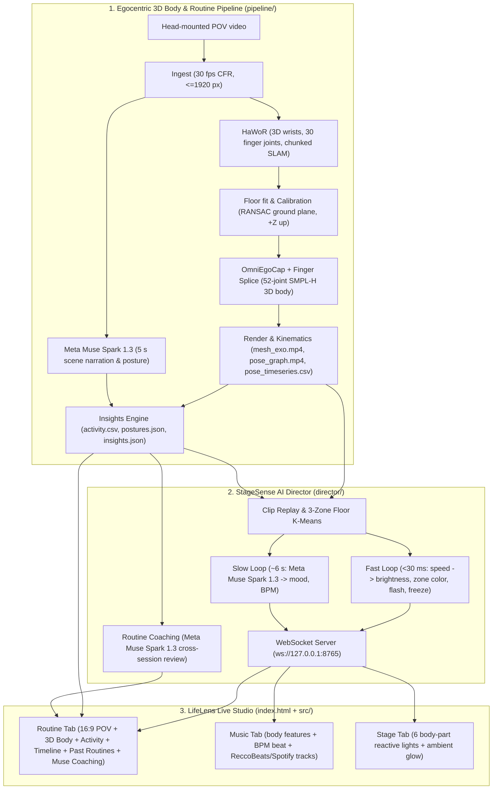
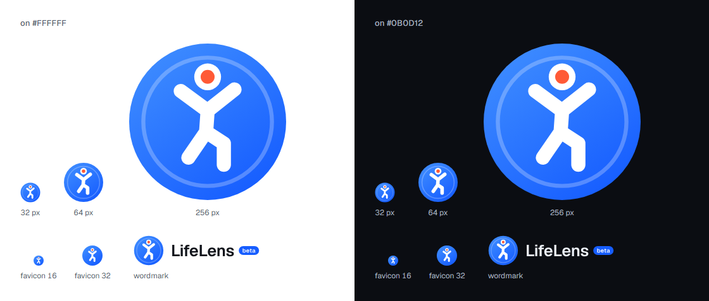

<p align="center">
  <picture>
    <source media="(prefers-color-scheme: dark)" srcset="docs/brand/logo-wordmark-on-dark.svg">
    <source media="(prefers-color-scheme: light)" srcset="docs/brand/logo-wordmark.svg">
    
  </picture>
</p>

# LifeLens

[](https://github.com/nshreyasvi/LifeLens/releases/tag/demos-v1)
[](#1-set-up-linux-or-wsl2-nvidia-gpu-with-8-gb-cuda-126)
[](#1-set-up-linux-or-wsl2-nvidia-gpu-with-8-gb-cuda-126)
[](#front-end-lifelens-live-studio)
[](#director-stagesense)
[-C83E1B?style=flat-square)](#how-the-end-to-end-workflow-operates)
[](director/TESTING.md)
[](#licenses)

A head-mounted **phone, smart glasses (Meta Ray-Ban), or GoPro** video goes in. The wearer's whole body comes out in 3D—even though the camera never sees it—together with what they do, how they move over the day, and live stage lighting and music recommendations driven by their movement.


*Reconstructed 3D SMPL-H body + articulated hands from a head-mounted camera alone, with scrolling biomechanical telemetry underneath (left to right: knee, hip, and elbow flexion, trunk lean, and walking speed). Pre-rendered example sessions are in [`examples/office`](examples/office) and [`examples/outdoor`](examples/outdoor).*

| Output | What it is |
|---|---|
| **3D motion** | SMPL-H body with 30 articulated finger joints, 30 fps, as `.npy` / `.csv` / AMASS `.npz` |
| **Synchronized POV + 3D body** | 16:9 edge-to-edge head-camera POV, 3D exocentric mesh (`mesh_exo.mp4`), and scrolling kinematics graph (`pose_graph.mp4`) |
| **Scene narration & posture** | Every 5 s: **Meta Muse Spark 1.3** narrates the activity (`narration_muse.json`) and classifies posture (`posture_muse.json`) alongside 3D biomechanical rules |
| **Routine & past routines** | Per-second posture breakdown, interactive timeline scrubber, cross-session comparison (`Past routines`), and **Meta Muse Spark** coaching cards |
| **Live music & stage lighting** | WebSocket director (`FastLoop` + `SlowLoop`) driving biomechanical music features, ReccoBeats/Spotify songs, and 6 body-part stage lights |


*Second-by-second posture timeline on [`examples/office`](examples/office/insights.md) (`walking`, `standing`, `sitting`, `bending`, `crouching`, `arms raised`), computed from leg-length-normalized biomechanical rules on the reconstructed 3D body and paired with Meta Muse Spark captions.*

**Try it immediately:** [`examples/`](examples) holds **2 complete example sessions**—[`examples/office`](examples/office) (83 s indoor office routine) and [`examples/outdoor`](examples/outdoor) (105 s outdoor walk)—with POV video, 3D SMPL-H body mesh video, kinematics graph, Meta Muse Spark captions, posture classifications, and cross-session routine coaching. Legacy scripts and retired experiments are cleanly archived in [`archive/`](archive).

---

## How the End-to-End Workflow Operates

LifeLens is organized into **three connected layers** controlled entirely by Python and Node.js:

1. **3D Body & Meta Muse Spark Pipeline (`pipeline/`)** — Reconstructs 3D full-body + 30-joint finger kinematics from head-mounted video, renders synchronized videos, narrates 5 s windows with **Meta Muse Spark 1.3**, and classifies second-by-second posture.
2. **StageSense Director (`director/`)** — Streams processed kinematics over `ws://127.0.0.1:8765` through a dual-speed architecture (**Fast Loop** for `<30 ms` reactive cues + **Slow Loop** powered by **Meta Muse Spark 1.3** for mood, tempo, and routine coaching).
3. **LifeLens Live Studio (`index.html`, `src/`, `vite.config.js`)** — A Vite web studio with custom optical & kinematic vector graphics, a 2-column Studio Launcher (`New live session` or `Open a recording`), a dedicated **Processing Studio Loading Screen** with live 0–100% progress bar and GPU/CPU hardware telemetry (`nvidia-smi` + host processor), and three integrated views: **Routine** (containing live Activity, POV, 3D body, Session Routine, Past Routines, and Muse Spark Coaching), **Music**, and **Stage**.



### Stage-by-Stage Pipeline Breakdown (`pipeline/run.py`)

When you run `python pipeline/run.py <video> <run_name>` (or finish recording a **New live session** in the web studio), each stage writes to `runs/<run_name>/` and reports live stage progress (`0% → 100%`) and hardware telemetry to the studio UI:

1. **Ingest (`input.mp4`)**: Transcodes the raw input video via `ffmpeg` to a constant 30 fps, `<=1920` px width, `yuv420p` working video.
2. **Hand & SLAM Tracking ([`pipeline/hawor_export.py`](pipeline/hawor_export.py) → `wrist.npz`, `slam.npz`)**: Runs [HaWoR](https://github.com/ThunderVVV/HaWoR) to detect 3D left/right wrists and 15-joint MANO finger rotations (`hand_pose` `(N, 90)`), and runs chunked DROID-SLAM (`hawor_slam`) stitched via Umeyama similarity alignment to recover the 6-DoF camera trajectory.
3. **Floor Plane & Gravity Alignment ([`pipeline/build_input.py`](pipeline/build_input.py) → `omniegocap_input.npz`, `calibration.json`)**: Fits a RANSAC ground plane to the SLAM point cloud so world $+Z$ points opposite gravity with the floor at $z = 0$.
4. **Full-Body 3D Reconstruction ([`pipeline/run_omniegocap.py`](pipeline/run_omniegocap.py) → `smplh_canonical.npz`, `smplh.npz`, `kinematics/`)**: Runs [OmniEgoCap](https://github.com/KyungWonCho/OmniEgoCap) to infer the 22-joint full-body trajectory from head + wrist motion, applies Gaussian smoothing (`--smooth 2.0`), and splices in HaWoR's 30 finger joints.
5. **3D Mesh & Pose Graph Rendering ([`pipeline/render.py`](pipeline/render.py) → `side_by_side.mp4`, `mesh_exo.mp4`, `pose_graph.mp4`, `pose_timeseries.csv`)**: Renders the 3D SMPL-H body from a smooth exocentric camera on a checkerboard floor alongside a scrolling biomechanical telemetry graph.
6. **Meta Muse Spark Narration ([`pipeline/describe_muse.py`](pipeline/describe_muse.py) → `narration_muse.json`)**: Queries **Meta Muse Spark 1.3** over 5 s windows to narrate what the wearer is doing from the POV frames.
7. **Posture & Daily Insights ([`pipeline/insights.py`](pipeline/insights.py), [`director/posture_muse.py`](director/posture_muse.py), [`bench/posture_sources.py`](bench/posture_sources.py), & [`director/routine_tips.py`](director/routine_tips.py) → `activity.csv`, `posture_muse.json`, `postures.json`, `insights.json`, `insights.md`)**: Computes per-second posture labels from 3D biomechanical rules and **Meta Muse Spark**, compares agreement (`postures.json`), and generates structured cross-session routine coaching via **Meta Muse Spark 1.3**.

---

## Front-end: LifeLens Live Studio

The interactive web interface runs on **Vite** ([`index.html`](index.html), [`vite.config.js`](vite.config.js), [`src/main.js`](src/main.js), [`src/start.js`](src/start.js), [`src/session.js`](src/session.js), [`src/live.js`](src/live.js), [`src/media.js`](src/media.js), [`src/day.js`](src/day.js), [`src/extras.js`](src/extras.js)).

### Quick Start

```sh
npm install
npm run dev     # starts http://localhost:8000 with /api/hardware, /api/recordings, /api/live/*, and /api/process
```

### Brand Identity & Design System (`docs/brand/`)

LifeLens uses an optical hardware aesthetic inspired by smart-glasses instrumentation (**Warm Mineral Alabaster & Optical Cobalt** `#2B44E8` in Light mode; **Anodized Carbon & Optical Indigo** `#3B55F5` with **Signal Vermilion** `#C83E1B` recording accents in Dark mode), paired with an ambient optical & kinematic SVG vector backdrop across both the Start Screen and Studio views. Vector brand assets and palette tokens live in [`docs/brand/`](docs/brand) and [`public/logo-mark.svg`](public/logo-mark.svg).



### Studio Views & Live Recording Workflow

1. **Studio Launcher (`#start`)**: Features an interactive 2-column showcase with a custom SVG vector diagram (`POV Optics → 3D SMPL-H + Hands → Muse Spark & Stage`), live local GPU & CPU hardware detection (`/api/hardware`), personalized creator greeting, and session selection (**New live session** or **Open a recording**).
2. **Processing Studio Loading Screen (`#process-screen`)**: When you finish recording a live session (or click **Process** on a raw clip), LifeLens immediately displays your newly recorded POV clip alongside a live `0% → 100%` progress bar, an 8-stage pipeline checklist, live terminal output, and real-time GPU (`nvidia-smi` VRAM, load %, temperature) and CPU processor telemetry.
3. **Routine Tab (`#view-activity` + `#view-day`)**: Combines the top **Activity & POV Studio Deck** (edge-to-edge `16:9` head-camera POV without letterbox bars, docked 3D SMPL-H body, scrolling kinematics strip, live activity energy meter, and activity cue stream) with the **Activity Breakdown**, **Interactive Timeline & Log** (`3D Rules`, `Muse Spark`, `Combined`), **Past Routines** cross-session comparison cards, and concise **Meta Muse Spark Coaching** cards.
4. **Music & Stage Tabs (`#view-music`, `#view-stage`)**: Maps the last 10 s of 3D body biomechanics into a live BPM beat and **ReccoBeats / Spotify** song recommendations with embedded audio playback, plus **6 body-coupled stage lights** that pulse to limb velocity, director mood color, and beat flashes.

---

## 1. Set up (Linux or WSL2, NVIDIA GPU with 8 GB, CUDA 12.6)

Create the conda environments (`omniegocap`, `hawor`, `mhr`, `vlm`) and place the licensed body models (free registration at https://mano.is.tue.mpg.de):

| Download | Put it at |
|---|---|
| SMPL-H "Extended SMPL+H model" `smplh.tar.xz` | `tar -xJf smplh.tar.xz -O neutral/model.npz > third_party/OmniEgoCap/data/smplh/SMPLH_NEUTRAL.npz` |
| MANO `mano_v1_2.zip`: `models/MANO_RIGHT.pkl` | `third_party/HaWoR/_DATA/data/mano/` |
| MANO `mano_v1_2.zip`: `models/MANO_LEFT.pkl` | `third_party/HaWoR/_DATA/data_left/mano_left/` |

Check the install:

```bash
conda activate omniegocap && python bench/smoke_test.py
```

## 2. Run the 3D Pipeline on a Video

```bash
conda activate omniegocap
python pipeline/run.py my_walk.mov my_walk                    # → runs/my_walk/
```

| Flag | Meaning |
|---|---|
| `--focal F` | Focal length in pixels of the `<=1920` px working video. If omitted, read from an iPhone video's lens metadata |
| `--describe muse` | Description model: `muse` (default, Meta Muse Spark activity narration), `none` |
| `--smooth S` | Body smoothing in frames (default `2`); `0` = OmniEgoCap's raw output, as in the paper |
| `--input_npz F` | A ready OmniEgoCap input (e.g. OmniEgoDB's `input.npz`): no SLAM, HaWoR only for the fingers |
| `--opt` | OmniEgoCap's wrist optimization: same body error, 71% more jerk, 2–3× slower (paper, Table 3) |

## 3. Outputs: `examples/<name>/` and `runs/<name>/`

| File | Content |
|---|---|
| `side_by_side.mp4` | Camera \| 3D body, pose graph underneath (knee, hip, elbow flexion, trunk lean, speed) |
| `mesh_exo.mp4`, `pose_graph.mp4` | The 3D body and the kinematics graph alone; frame *i* = `input.mp4` frame *i*, 30 fps |
| `kinematics/joints_world.csv` / `.npy` | `(L, 22, 3)` joint positions, meters, $+Z$ up, floor at $z = 0$ |
| `kinematics/joint_rotations.csv` / `.npy` | `(L, 52, 3)` SMPL-H axis-angle: root, 21 body joints, 30 finger joints |
| `pose_timeseries.csv` | The graph's angles (deg), pelvis height (m), walking speed (m/s), and limb speeds per frame |
| `narration_muse.json` | Meta Muse Spark 1.3: one sentence per 5 s |
| `posture_muse.json`, `postures.json` | Per-5 s posture labels across 3D biomechanical rules, Meta Muse Spark, and Combined consensus |
| `insights.md`, `insights.json`, `activity.csv`, `activity.png` | Posture per second with narration, time split, Muse Spark routine review, and session history |
| `smplh.npz` | AMASS SMPL-H layout (with fingers), for Blender / AMASS tools and OmniEgoCap's viewer and evaluator |
| `calibration.json` | Own-video mode: floor fit and camera height |
| `manifest.json` | File index and per-stage timings |

## 4. Results (RTX 4060 Laptop 8 GB)

Pose error against OmniEgoDB's Xsens motion capture, OmniEgoCap's evaluator, 13,737 frames, in `--input_npz` mode:

| | office | outdoor | robothome (benchmark) | all three | paper (20 seq.) |
|---|---|---|---|---|---|
| MPJPE (mm), smoothed (default) | 93.9 | 101.7 | 105.6 | **102.6** | 111.7 |
| MPJPE (mm), raw (`--smooth 0`) | 94.2 | 102.8 | 105.8 | 103.0 | |
| Hand error (mm), smoothed / raw | 159 / 160 | 110 / 115 | 135 / 136 | **134.0** / 135.7 | 166.2 |
| Jerk (km/s³), smoothed / raw | 0.02 / 0.07 | 0.03 / 0.08 | 0.01 / 0.07 | **0.016** / 0.075 | 0.073 |

## 5. Director (StageSense)

The director ([`director/server.py`](director/server.py)) reads `pose_timeseries.csv`, `activity.csv`, and `kinematics/joints_world.csv` from a processed LifeLens recording (`examples/office` or `examples/outdoor`) and streams JSON stage & music cues over `ws://127.0.0.1:8765` to the front-end. When running `npm run dev`, pressing **Play** in the UI automatically starts the director via `POST /api/live/start`.

See [director/README.md](director/README.md) and [director/TESTING.md](director/TESTING.md) (62 passing unit tests) for details.

## Licenses

No license is set for this code yet. Not included and non-commercial: OmniEgoCap's checkpoint (CC BY-NC 4.0), SMPL-H and MANO, OmniEgoDB (CC BY-NC, gated). Fine for research and demos, not for a product. The release demos are derived from OmniEgoDB and inherit CC BY-NC.
