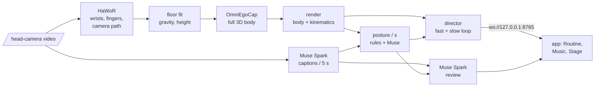

<p align="center">
  <picture>
    <source media="(prefers-color-scheme: dark)" srcset="docs/brand/logo-wordmark-on-dark.svg">
    
  </picture>
</p>

<p align="center">
  <a href="https://github.com/nshreyasvi/LifeLens/releases/tag/demos-v1"></a>
  <a href="#run-the-app"></a>
  <a href="#where-every-result-comes-from"></a>
  <a href="#how-it-works"></a>
  <a href="#music-and-stage"></a>
  <br>
  <a href="#platforms"></a>
  <a href="#platforms"></a>
  <a href="#set-up-the-pipeline"></a>
  <a href="director/TESTING.md"></a>
  <a href="#licenses"></a>
</p>

LifeLens takes a video from a camera on your head (phone, smart glasses or GoPro) and rebuilds your whole body in 3D,
though the camera never sees it. From that body and the video it tells you what you did, how you moved and what you
could change, and it drives music and stage lights from your movement.

[](docs/demo.mp4)

*The demo at 2× speed ([full video, 63 s](docs/demo.mp4)). It shows the `office` recording: the director plays it
live, the Routine tab shows Muse Spark's review, the Music tab picks songs from the body, and the Stage tab lights
each body part. The head-camera video is hidden: it is OmniEgoDB footage and can't be redistributed. So the 3D body
fills the main window, as it does on any machine without the dataset.*

## What you get

| From | You get | Made by |
|---|---|---|
| The head-camera video | Your 3D body (SMPL-H, 30 finger joints, 30 fps) and its joint angles | HaWoR (hands, camera path) → OmniEgoCap (body) |
| The video, every 5 s | A caption of what you are doing | Meta Muse Spark, from 3 frames |
| The body's numbers + the captions, every 5 s | A second posture label | Meta Muse Spark |
| The 3D body, every second | Posture: walking, standing, sitting, crouching, bending, arms raised | Fixed rules on the body (below) |
| All of the above | A review: what you did, what to change and why, compared with other recordings | Meta Muse Spark |
| The 3D body, live | Mood and tempo (every ~6 s), light cues (every frame) | Director: Muse Spark + speed rules |
| The last 10 s of the body | 5 songs that fit your pace, steps and arm swing; lights per body part, pulsing to the song's beat | ReccoBeats, Spotify |

## Run the app

```sh
npm install
python -m venv director/venv && director/venv/bin/pip install -r director/requirements.txt
cp director/.env.example director/.env     # then set MUSE_API_KEY=...
DIRECTOR_PYTHON=director/venv/bin/python npm run dev     # http://localhost:8000
```

On Windows the venv's Python is `directorenv\Scripts\python.exe`; the dev server finds either one by itself.

Enter your name, then pick one:

- **Open a recording.** The two examples ([`examples/office`](examples/office), 83 s indoors;
  [`examples/outdoor`](examples/outdoor), 105 s outside) work without a GPU. So does any run in `runs/`. A video
  dropped in `recordings/` gets a **Process** button.
- **New live session.** Your camera becomes the POV, and every 6 s Muse Spark captions two frames and names your
  posture over it. **Record**, then **Stop**: the dev server runs the pipeline on the clip and opens it when it's done.

**Play** starts the director on the open recording. **Routine** shows the POV, the 3D body and the kinematics, the
posture timeline (rules, Muse Spark, or the seconds where both agree), the Muse review and the other recordings.
**Music** and **Stage** keep playing while you switch between them.

The `director/.env` file is gitignored; the browser never sees the key. Without `director/.env`, the director runs on
its speed rules only, and the app shows no mood or songs rather than defaults. With an empty key it falls back to a
local Llama 3.2 through Ollama, when one is running.

## How it works



`python pipeline/run.py <video> <name>` runs steps 1–7 into `runs/<name>/`; **Process** in the app also runs the Muse
posture labels and the review. Each stage is skipped when its output exists; delete the file to redo it.

1. **Ingest:** ffmpeg makes a 30 fps working video, at most 1920 px wide.
2. **HaWoR** ([`hawor_export.py`](pipeline/hawor_export.py)) finds the wrists and 15 finger joints per hand. DROID-SLAM
   then tracks the camera in 30 s pieces, which are joined by aligning their overlaps.
3. **Floor fit** ([`build_input.py`](pipeline/build_input.py)): a plane through the SLAM points sets "up" and the
   floor.
4. **OmniEgoCap** ([`run_omniegocap.py`](pipeline/run_omniegocap.py)) infers the 22-joint body from head and wrist
   motion. The legs are a learned estimate, not seen. The body is then smoothed and HaWoR's fingers are added.
5. **Render** ([`render.py`](pipeline/render.py)): the body from outside, plus a scrolling graph of knee, hip and
   elbow flexion, trunk lean and walking speed.
6. **Captions** ([`describe_muse.py`](pipeline/describe_muse.py)): Muse Spark gets 3 frames per 5 s.
7. **Insights** ([`insights.py`](pipeline/insights.py)): a posture every second, a time split and breaks. Then the
   Muse posture labels ([`posture_muse.py`](director/posture_muse.py)), the posture sources
   ([`posture_sources.py`](bench/posture_sources.py)) and the review ([`routine_tips.py`](director/routine_tips.py)),
   which **Process** runs after `run.py`. The review saves its whole prompt, which the app shows under
   **View Meta Muse Spark prompt payload**.

If the 3D body fails, for example because SLAM had too little motion, the run stops with the error. It never
borrows another recording's body.

## Where every result comes from

Nothing in the app is sample data. Each value comes from a model, from fixed rules applied to the 3D body, or from a
fixed formula, as listed here.

| Shown | Source | Fixed parts to know |
|---|---|---|
| 3D body, joint angles, speed | HaWoR + OmniEgoCap on your video | Smoothing σ = 2 frames; the camera's offset from the head is fixed at (0, 0.16, 0.12) m |
| Captions | Muse Spark, 3 frames per 5 s | Muse can misread a frame |
| Posture "Rules" | [`insights.py`](pipeline/insights.py) on the 3D body | Walking > 0.5 m/s; a low posture held 8 s or more counts as sitting; tuned on the demo clips |
| Posture "Muse Spark" | Muse, from the body's numbers and the captions, per 5 s | Shows unknown where Muse gave no label |
| Posture "Both agree" | The seconds where the rules and Muse name the same posture | Grey where they differ |
| Agreement % (examples only) | Against the same rules run on OmniEgoDB's motion capture | It shares the rules' thresholds, so it favors the rules: agreement, not accuracy |
| Review | Muse Spark, from the posture log, captions and totals | Other recordings may be other people (the two examples are different OmniEgoDB wearers) |
| Mood, tempo | Muse Spark every ~6 s | Tempo moves toward the mood's BPM range by at most 10 BPM per update ([`music_map.py`](director/music_map.py)) |
| Light brightness, flashes, freeze | Speed rules ([`fast_loop.py`](director/fast_loop.py)) | Flash at ≥ 0.5 m/s and 0.3 m/s above the last 4 s. The freeze "predictor" is a stand-in with a fixed score |
| Energy (low/medium/high) | Pelvis speed divided by the clip's own 95th percentile | Relative to the clip, not absolute |
| Song targets | The last 10 s of the body | Fixed formulas in [`main.js`](src/main.js) (`musicTargets`) |
| Songs, BPM | ReccoBeats recommendations, seeded by its top search result for the mood; BPM is each song's measured tempo | Spotify plays a 30 s preview unless you are logged in |
| Processing % | Which pipeline stages have started | Fixed weights per stage; no timer moves it |

## Music and stage

| Body (last 10 s) | Song target |
|---|---|
| Pace (m/s), arm swing (°) | Energy |
| Step cadence, or arm swing when standing | Danceability, and the tempo when you walk (60 steps/min or more) |
| How upright, plus the mood | Valence |
| Share of time still | Acousticness |

ReccoBeats gets new targets at most every 15 s, and only when they changed. The player finishes the current song and
then plays the first song of the newest list. Each light follows one body part: left/right arm, left/right leg, torso,
pace. The director sets the color and flashes, and every light pulses on the beat of the song playing.

## Platforms

| | Linux / WSL2 + NVIDIA (CUDA 12.6, 8 GB) | macOS, Apple Silicon (MPS) |
|---|---|---|
| App, director, live captions, reviews, songs | yes | yes |
| Your own video → 3D body | yes | **no**: DROID-SLAM (the camera path) only has CUDA kernels |
| A ready camera path (`--input_npz`) → 3D body | yes | OmniEgoCap on MPS, HaWoR's hands on the CPU (untested on a Mac) |

Every torch stage picks CUDA, then MPS, then the CPU ([`pipeline/device.py`](pipeline/device.py)). If a model hits an
operation MPS lacks, set `LIFELENS_DEVICE=cpu`. On macOS, rendering uses pyglet instead of EGL. The dev server reads
your conda folder from `CONDA_ROOT` (default `~/anaconda3`).

## Set up the pipeline

```bash
bash archive/scripts/setup.sh     # conda envs omniegocap, hawor, mhr, vlm; upstream code; weights; HaWoR patch
```

The body models need a free registration at https://mano.is.tue.mpg.de:

| Download | Put it at |
|---|---|
| SMPL-H "Extended SMPL+H model" `smplh.tar.xz` | `tar -xJf smplh.tar.xz -O neutral/model.npz > third_party/OmniEgoCap/data/smplh/SMPLH_NEUTRAL.npz` |
| MANO `mano_v1_2.zip`: `models/MANO_RIGHT.pkl` | `third_party/HaWoR/_DATA/data/mano/` |
| MANO `mano_v1_2.zip`: `models/MANO_LEFT.pkl` | `third_party/HaWoR/_DATA/data_left/mano_left/` |

To check the install: `conda activate omniegocap && python bench/smoke_test.py`.

```bash
conda activate omniegocap
python pipeline/run.py my_walk.mov my_walk        # → runs/my_walk/
```

| Flag | Meaning |
|---|---|
| `--focal F` | Focal length (px) of the 1920 px working video. iPhone videos carry it; for other cameras it is `960 / tan(hfov / 2)` |
| `--input_npz F` | A ready OmniEgoCap input (e.g. OmniEgoDB's `input.npz`): no SLAM; HaWoR runs only for the fingers |
| `--smooth S` | Body smoothing in frames (default 2; 0 is OmniEgoCap's raw output) |
| `--describe none` | Skip the Muse captions |
| `--opt` | OmniEgoCap's wrist optimization: same body error, 71% more jerk, 2–3× slower |

Recording your own video:
- Fix the camera to your head (strap or cap), tilted 20–30° down so your hands and some floor are in view.
- Stand still for the first 3 s.
- Keep clips under 2 min, and walk around: SLAM needs motion.

## Results (RTX 4060 Laptop, 8 GB)

**3D body vs OmniEgoDB's Xsens motion capture.** OmniEgoCap's evaluator, `--input_npz` mode, 13,737 frames:

| | office | outdoor | robothome | all three | paper (20 seq.) |
|---|---|---|---|---|---|
| MPJPE (mm) | 93.9 | 101.7 | 105.6 | **102.6** | 111.7 |
| Hand error (mm) | 159 | 110 | 135 | **134.0** | 166.2 |
| Jerk (km/s³) | 0.02 | 0.03 | 0.01 | **0.016** | 0.073 |

This covers three of the paper's 20 sequences, so it checks the pipeline; it does not rank it. Own-video mode (our
SLAM) is not measured.

**Posture agreement with the motion-capture labels**, share of seconds:

| | Rules | Muse Spark | Both agree | Always "standing" |
|---|---|---|---|---|
| office (83 s) | 100% | 84% | 84% | 63% |
| outdoor (105 s) | 90% | 79% | 77% | 30% |

The motion-capture labels come from the same rules run on the Xsens skeleton, so they favor the rules column: this
is agreement, not accuracy.

**Speed** ([`bench/live_fps.py`](bench/live_fps.py), a 10 s own-video clip):

| Stage | Seconds per video second |
|---|---|
| HaWoR: hands + DROID-SLAM | 30–77 (78–85% of the total) |
| OmniEgoCap | 2.2–3.5 |
| Render | 2.2–3.9 |
| Captions | 1.3–1.6 with the local Qwen3-VL used when this was measured; Muse Spark now takes 3.4–3.7 (one call per 5 s, office and outdoor) |
| Whole pipeline | **39–90**, i.e. 0.3–0.8 fps against the 30 fps of live video |
| Director fast loop | 0.06 ms per frame |

The run was measured when captions and the summary still used the local Qwen3-VL (3.3–3.7 s per video second
together). Muse Spark's captions take about the same, 3.4–3.7, so the total is about the same.

So the 3D body cannot be live on this laptop; it would need a machine 40–90× faster. The live session therefore shows
Muse's captions (about 7 s per reply) and builds the body after you stop.

## Limits

- **Legs** are OmniEgoCap's estimate from head and wrist motion; the camera never sees them. Uneven ground outdoors
  reads as bent knees.
- **Fingers** come from HaWoR only where it detects a hand (24–46% of frames in the demos). Gaps up to 0.5 s are
  interpolated; longer ones ease to the clip's average hand.
- **Feet** sink 2–4 cm into the floor in OmniEgoCap's output. The video lifts the drawn body; the exported motion
  doesn't.
- **History:** the review compares recordings, but the two examples are different people. Record several sessions
  of yourself for a real history.
- **Muse Spark** can misread a frame or time out (3 retries). Its mood updates stop after 30 calls per Play
  (`--max-muse-calls`).
- **Freeze** detection is a stand-in (a fixed score after a sustained stop), not a trained model.

## Director

[`director/server.py`](director/server.py) replays a processed recording and streams JSON cues over
`ws://127.0.0.1:8765`. The fast loop (every frame) sets brightness, zone color and flashes from speed. The slow loop
(about every 6 s) asks Muse Spark for mood and tempo. The app starts and stops it with **Play** and **Pause**. More
in [director/README.md](director/README.md) and [director/TESTING.md](director/TESTING.md):
`python -m pytest director/tests -q`, 70 passed.

## Licenses

No license is set for this code yet. These are not included and are non-commercial:

- OmniEgoCap's checkpoint (CC BY-NC 4.0)
- SMPL-H and MANO
- OmniEgoDB (CC BY-NC, gated)

That's fine for research and demos, but not for a product. The example recordings are derived from OmniEgoDB and
inherit CC BY-NC. © 2026 LifeLens team.
