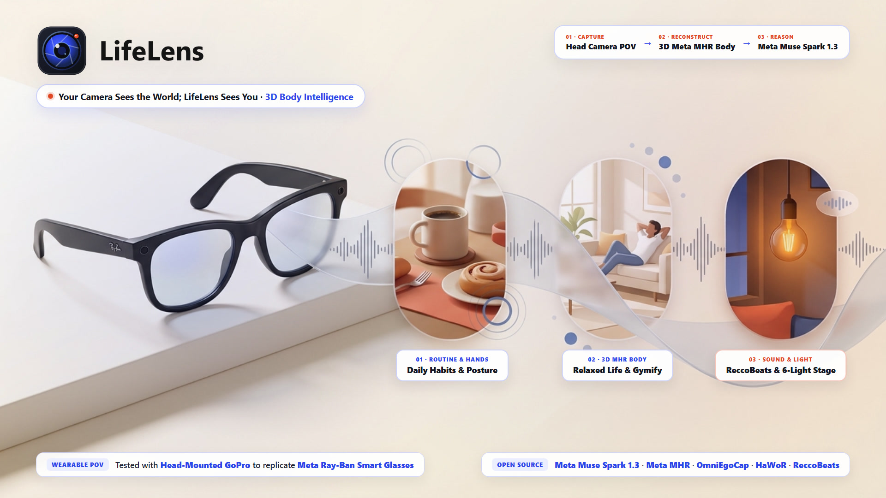

<p align="center">
  
</p>

<h1 align="center">LifeLens</h1>

<p align="center">
  <b>Your camera sees the world; LifeLens sees you — turning first-person vision into 3D body intelligence.</b>
</p>

<p align="center">
  <a href="https://dev.meta.ai/docs/quickstart"></a>
  <a href="https://github.com/facebookresearch/momentum"></a>
  <a href="https://ollama.com/library/llama3.2"></a>
  <a href="https://github.com/MiroPsota/OmniEgoCap"></a>
  <a href="https://github.com/ThunderVVV/HaWoR"></a>
  <a href="https://reccobeats.com/"></a>
  <a href="https://www.meta.com/ai-glasses/"></a>
  <a href="LICENSE"></a>
</p>

<p align="center">
  <a href="#why-lifelens">Why LifeLens</a> ·
  <a href="#video-demo">Video Demo</a> ·
  <a href="#dashboard--feedback-systems-overview">Dashboard Tour</a> ·
  <a href="#everyday-use-cases">Use Cases</a> ·
  <a href="#full-end-to-end-pipeline-architecture">Full Pipeline</a> ·
  <a href="#project-structure">Project Structure</a> ·
  <a href="#installation--quick-start">Quick Start</a> ·
  <a href="#documentation-hub">Docs Hub</a>
</p>

---

## Why LifeLens

Smart glasses like **[Meta Ray-Ban Glasses](https://www.meta.com/ai-glasses/)** and head-mounted cameras look *outward* at the world — they see your coffee cup, your desk, or the mountain ahead, **but they never see your own body**.

**LifeLens makes your unseen body visible and turns your daily motion into gentle, actionable feedback.**

- **Tested with a Head-Mounted GoPro to Replicate Meta Ray-Ban Smart Glasses:** Tested on real first-person recordings captured with a **head-mounted GoPro** configured to match the field of view and head motion of **Meta Ray-Ban Smart Glasses** (and compatible with phone head-mounts and wearable action cameras).
- **100% Open-Source 3D Body Reconstruction (`OmniEgoCap` + `Meta MHR`):** Uses open-source **[OmniEgoCap](https://github.com/MiroPsota/OmniEgoCap)**, **[HaWoR](https://github.com/ThunderVVV/HaWoR)**, **[DROID-SLAM](https://github.com/princeton-vl/DROID-SLAM)**, and **[Metric3D v2](https://github.com/YvanYin/Metric3D)** paired with **[Meta MHR (Momentum Human Rig)](https://github.com/facebookresearch/momentum)** to reconstruct your **full 22-joint 3D body and 30-joint hands** in world space from a single head-mounted camera.
- **Activity, Effectiveness & Mood Understanding (`Meta Muse Spark 1.3`):** **[Meta Muse Spark 1.3](https://dev.meta.ai/docs/quickstart)** (with **[Meta Llama 3.2](https://ollama.com/library/llama3.2)** for offline local mode) inspects **both your first-person activity images and your 3D MHR body renders** to understand **what activity you were doing**, **how effective your movement was**, and **how you feel** — powering **better daily routines and a more relaxed life**, **better training**, **mood-matched music via open-source [ReccoBeats](https://reccobeats.com/)**, and **dance choreography & stage performance**.

---

## Video Demo

<p align="center">
  <a href="docs/lifelens-demo.mp4">
    
  </a>
  <br/>
  <sub>🎬 Click the animated preview above to watch <a href="docs/lifelens-demo.mp4"><b>docs/lifelens-demo.mp4</b></a> (full 2:08 HD walkthrough with voiceover — 3D MHR body reconstruction, render-to-reason with Meta Muse Spark, and live UI tour across Routine, Music, Stage &amp; Gymify).</sub>
</p>

---

## Dashboard & Feedback Systems Overview

> Interactive dashboard previews showing what you can click and open across all four workspace tabs. Full walkthrough: **[`docs/UI_GUIDE.md`](docs/UI_GUIDE.md)**

<table width="100%">
  <tr>
    <th width="50%" align="left">🧭 Routine Feedback System Dashboard</th>
    <th width="50%" align="left">🏋️ Gymify Training Feedback System UI</th>
  </tr>
  <tr>
    <td width="50%" valign="top">
      <a href="docs/UI_GUIDE.md#1-routine--relaxed-life-feedback-system-routine-tab">
        
      </a>
      <br/>
      <sub>Open a session, press <b>Play</b> to sync your POV and 3D Meta MHR body, click any 5s snapshot on the <b>Activity Timeline</b> to jump the video, and inspect <b>Past Sessions</b> &amp; <b>Meta Muse Spark</b> tips.</sub>
    </td>
    <td width="50%" valign="top">
      <a href="docs/UI_GUIDE.md#2-gymify-training-feedback-system-gym-tab">
        
      </a>
      <br/>
      <sub>Switch to the <b>Gym</b> tab to inspect live 3D MHR joint angles and rep counts, then click individual <b>Rep 1 / Rep 2 / Rep 3</b> cards to review <code>136°</code> squat depth, tempo, and left–right symmetry.</sub>
    </td>
  </tr>
  <tr>
    <th width="50%" align="left">🎵 ReccoBeats Music &amp; Day Vibe Dashboard</th>
    <th width="50%" align="left">💃 Dance Choreography &amp; 6-Light Stage Dashboard</th>
  </tr>
  <tr>
    <td width="50%" valign="top">
      <a href="docs/UI_GUIDE.md#3-unified-video--music-player--day-vibe-music-tab">
        
      </a>
      <br/>
      <sub>Switch to the <b>Music</b> tab, press <b>Play</b>, and click across clip window segments to jump the video and switch matched open-source <b>ReccoBeats</b> tracks + <b>Your Day Vibe in a Song</b>.</sub>
    </td>
    <td width="50%" valign="top">
      <a href="docs/UI_GUIDE.md#4-dance-choreography--virtual-stage-performance-stage-tab">
        
      </a>
      <br/>
      <sub>Switch to the <b>Stage</b> tab to watch your 3D MHR performer drive <b>6 reactive stage lights</b> mapped to your arms, legs, torso, and pace, with <b>Stagify</b> multi-scene DMX / Hue show cues.</sub>
    </td>
  </tr>
</table>

---

## Everyday Use Cases

| Everyday Use Case | How Meta Muse Spark + Meta MHR + Open-Source Models Help You |
|---|---|
| 🌿 **Routine Feedback System & A More Relaxed Life** | **Meta Muse Spark** looks at your first-person activity images and your **3D Meta MHR body** every 5 seconds to recognize what you are doing, measure posture balance (`Sitting`, `Standing`, `Crouching`, `Reaching`), and advise you based on how you feel — helping you spot tension, take mindful breaks, and live a calmer, more relaxed life. |
| 🏋️ **Better Training (`Gymify` Feedback System)** | Evaluates **what exercise you are performing and how effective each rep is** directly from your 3D MHR joints and images — tracking `136°` squat knee flexion, hip hinge, rep tempo, and left–right symmetry with clickable per-rep feedback cards. |
| 🎵 **Mood-Matched Music & Day Vibe (`ReccoBeats`)** | Uses open-source **[ReccoBeats](https://reccobeats.com/)** audio feature matching to lock your video and music player in sync across movement windows and curates **Your Day Vibe in a Song** plus tracks to **Play Next Time You're Doing Similar Tasks**. |
| 💃 **Dance Choreography & Stage Performance (`Stagify`)** | Places your **3D MHR body** on a 6-light virtual stage where each spotlight reacts to your left/right arms, legs, torso, and pace — letting dancers and performers rehearse choreography and export live cues to [Art-Net DMX](https://art-net.org.uk/) & [Philips Hue](https://developers.meethue.com/). |

---

## Full End-to-End Pipeline Architecture

<p align="center">
  <picture>
    <source media="(prefers-color-scheme: dark)" srcset="docs/architecture-pipeline-dark.svg">
    
  </picture>
  <br/>
  <sub>Mermaid source: <a href="figures/lifelens-full-pipeline.mmd"><code>figures/lifelens-full-pipeline.mmd</code></a> · High-res PNG: <a href="figures/lifelens-full-pipeline.png"><code>figures/lifelens-full-pipeline.png</code></a></sub>
</p>

---

## Included 3D MHR Sessions (`examples/`)

| Session | Activity | Duration | Highlights |
|---|---|---|---|
| **`eating`** | Seated Meal & Hand Gestures | 27 s | High-visibility 3D hand & wrist reconstruction (`HaWoR` + `Meta MHR`) and relaxed seated posture feedback |
| **`exercising`** | Full-Body Bodyweight Squats | 35 s | **Gymify** automatic squat detection, `136°` peak knee flexion, and per-rep effectiveness feedback |
| **`snowboard-strap-in`** | Mountain Snowboard Binding Strap-In | 35 s | Ground-level crouch & forward reach reconstruction (`OmniEgoCap` + `Meta MHR`) |

---

## Project Structure

```text
LifeLens/
├── src/                  # Frontend Studio UI (Routine, Gymify, ReccoBeats Music, 6-Light Stage)
├── server/               # Hardware Art-Net DMX, Philips Hue & session replay backend
├── director/             # Agentic Director & Meta Muse Spark fast/slow loops + posture feedback
├── pipeline/             # 3D MHR + OmniEgoCap + HaWoR + DROID-SLAM + Metric3D + Muse Spark pipeline
├── scripts/              # One-command GPU environment setup (scripts/setup.sh)
├── examples/             # Pre-processed 3D MHR sessions (eating, exercising, snowboard-strap-in)
├── figures/              # Full-pipeline Mermaid diagrams (.mmd, .md, .png)
├── docs/                 # Documentation hub, brand assets, and interactive dashboard GIFs
├── bench/                # Real-time FPS & latency benchmarks
├── index.html            # Studio entry point
└── vite.config.js        # Vite server & local API routes
```

---

## Installation & Quick Start

You can explore all three 3D MHR sessions (`eating`, `exercising`, `snowboard-strap-in`) **immediately on any laptop — no GPU required**.

### 1. Clone & Install

```bash
git clone https://github.com/nshreyasvi/LifeLens.git
cd LifeLens
npm install

# Set up the Python environment for the live director & Meta Muse Spark
python -m venv director/venv
director/venv/bin/pip install -r director/requirements.txt   # Windows: director\venv\Scripts\pip install -r director/requirements.txt
```

### 2. Configure Meta Muse Spark (or Local Meta Llama 3.2)

```bash
cp director/.env.example director/.env
```

Add your [Meta Muse Spark API key](https://dev.meta.ai/docs/quickstart) to `director/.env` (or set `MODEL_PROVIDER=ollama` to run **[Meta Llama 3.2](https://ollama.com/library/llama3.2)** locally offline):

```ini
MUSE_API_KEY=your_meta_api_key_here
MUSE_MODEL=muse-spark-1.3
MUSE_REASONING=low
```

### 3. Launch LifeLens Studio

```bash
npm run dev
```

Open **`http://localhost:8000`** in your browser.

> **Want to run the 3D GPU pipeline on your own GoPro or Meta Ray-Ban videos?** See **[`docs/USAGE_AND_PIPELINE.md`](docs/USAGE_AND_PIPELINE.md)** for one-command WSL2 / Linux CUDA setup (`bash scripts/setup.sh`) and camera presets (`glasses`, `gopro-linear`, `gopro-wide`, `phone`).

---

## Documentation Hub

| Guide | What It Covers |
|---|---|
| 🖥️ **[UI & Feedback Systems Guide (`docs/UI_GUIDE.md`)](docs/UI_GUIDE.md)** | Interactive dashboard walkthrough of the **Routine Feedback System**, **Gymify Training Feedback System**, **ReccoBeats Music + Day Vibe**, and **Dance Choreography & Stage Show**. |
| ⚙️ **[Usage & 3D Pipeline Guide (`docs/USAGE_AND_PIPELINE.md`)](docs/USAGE_AND_PIPELINE.md)** | Step-by-step installation (`bash scripts/setup.sh`), camera calibration presets (**Head-Mounted GoPro** & **Meta Ray-Ban Glasses**), running `pipeline/run.py`, and hardware DMX / Hue lighting. |
| 🧠 **[Meta AI & Open-Source Models (`docs/MODELS_AND_ECOSYSTEM.md`)](docs/MODELS_AND_ECOSYSTEM.md)** | How **Meta MHR**, **Meta Muse Spark 1.3** (all 9 stages), **Meta Llama 3.2**, open-source **OmniEgoCap**, and open-source **ReccoBeats** work together, plus 3D MPJPE accuracy benchmarks (`102.6 mm`). |
| 🔬 **[Technical Deep Dive (`docs/DEEP_DIVE.md`)](docs/DEEP_DIVE.md)** | Calibration math, joint kinematics formulas, body-rhythm autocorrelation, and every output file schema. |

---

## Team

Built for the **Meta Global AI Developer Hackathon 2026**.

- **Shreyasvi Natraj**
- **Avinash Mantripragada**
- **Dhruv Patil**
- **Yash Ingle**

---

## Open Source License

**LifeLens is 100% open source under the [MIT License](LICENSE)** — there are **no non-commercial restrictions** on this repository, its studio application, the agentic director, the pipeline scripts, or our included example recordings and 3D MHR outputs in [`examples/`](examples). No restricted third-party weights or gated datasets are bundled in this repository.
