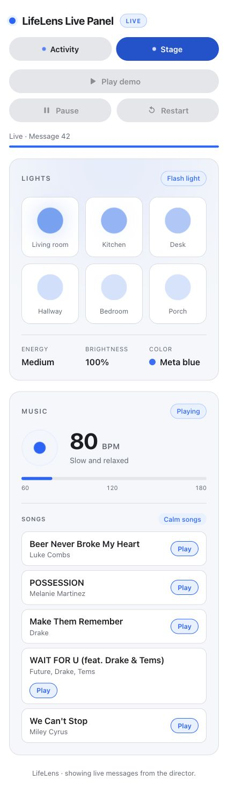

# StageSense Director

The director replays a processed LifeLens clip. Pose and activity data become light cues sent over a local WebSocket.

## How it works

The fast loop maps energy and zone to light level and colour. A measured pelvis-speed rise against the previous four seconds can trigger a reactive flash, mostly when walking starts; it is not a prediction. Freeze detection pre-arms a dim, then fires a blackout if the performer remains still. The slow loop sends a text summary to Muse Spark or local Llama and uses the validated result for mood and tempo.

The server sends JSON messages with these fields: `id`, `time`, `energy`, `action`, `music_tempo`, `phase`, `cue`, `intensity`, `color`, `zone`, `mood`, `source`, `reason`, `log`, `speed`, `posture_label`, `prediction_event`, `prediction_prob`, `scene`, `stem`, `shader`, `model_summary`, and `model_decision`. `action` is `dim | change_color | flash_light`; `cue` is `dim | blackout | flash | color`; `phase` is `prearm | fire | cancel | set | end`.

## Set up

From the LifeLens repository root:

```sh
python3 -m venv director/venv
source director/venv/bin/activate
python -m pip install -r director/requirements.txt -r director/requirements-dev.txt
cp director/.env.example director/.env
ollama pull llama3.2:3b
```

The model command downloads the local Llama model. For Muse, set `MODEL_PROVIDER=muse` and `MUSE_API_KEY` in `director/.env`; keep the key private.

## Run

```sh
source director/venv/bin/activate
MODEL_PROVIDER=ollama python -m director.server examples/office --start 42 --duration 30 --describe qwen
```

Open the front-end in Live mode with `npm run dev`; it connects to `ws://127.0.0.1:8765` when the director is running. For Muse, replace `MODEL_PROVIDER=ollama` with `MODEL_PROVIDER=muse` and drop `--duration 30`: the slow loop asks every 6 s but waits for the previous reply, and Muse replies took 9–22 s, so 30 s gives only about 2 updates. Add `--speed 2` to replay twice as fast or `--no-model` to skip the slow loop. The local preview is available at `director/samples/preview.html`.

**Live run on `examples/office` (Muse, `--start 42`)**



## Test

```sh
python -m pytest director/tests -q
```

## Results

The office clip, 23–53 s, ran with Llama 3.2 3B: `ollama ps` showed 2.2 GB, the slow loop returned 5/5 valid replies, and mean/max reply time was 2.11/2.23 s. Its screen messages had moods `calm`, `curious`, and `joyful`.

The office clip, 23–53 s, previously ran with Muse Spark: HTTP 200, 4/4 valid replies, and about 8 s mean reply time. In the full robothome clip at 2× speed, Muse returned 16/16 valid replies with 8.56 s mean and 16.08 s maximum latency; the screen mood counts were 415 calm and 425 curious.

Freeze thresholds were tuned on the office 23–53 s window. These replay results do not measure a live performance.
The current local test suite passes 62 tests.

A no-model fast-loop pass over the full clips produced reactive flashes and blackouts:

| Clip | Flash starts | Blackouts |
|---|---:|---:|
| office | 6 | 4 |
| outdoor | 7 | 1 |
| robothome | 9 | 6 |

## Known limits

* Energy is pelvis walking speed only; arm and hand movement and dancing in place do not trigger flashes.
* `speed_m_s` comes from `pipeline/render.py` with centred 15-frame smoothing, so replay flashes can land about 0.25 s early compared with live input.
* Flashes are reactive to a measured speed jump, not predicted. They mostly fire when walking starts.
* Freeze prediction uses the stand-in speed-drop predictor; its confidence value is a placeholder, not a calibrated probability.
* The demo replays a recorded clip; it is not a live camera feed yet.
* Tempo stays inside the chosen mood's range from `music_map.py` and moves at most 10 BPM per update, so after a mood change the tempo can take a few updates to arrive.
* The WebSocket has no authentication. Keep it bound to `127.0.0.1`.

## Credits

* [Muse Spark 1.3 and Meta Model API](https://dev.meta.ai/docs/quickstart)
* [Llama 3.2 through Ollama](https://ollama.com/library/llama3.2)
* [websockets](https://websockets.readthedocs.io/)
* [Pydantic](https://docs.pydantic.dev/)
* [python-dotenv](https://github.com/theskumar/python-dotenv)
* [certifi](https://github.com/certifi/python-certifi)
* [pytest](https://docs.pytest.org/)
