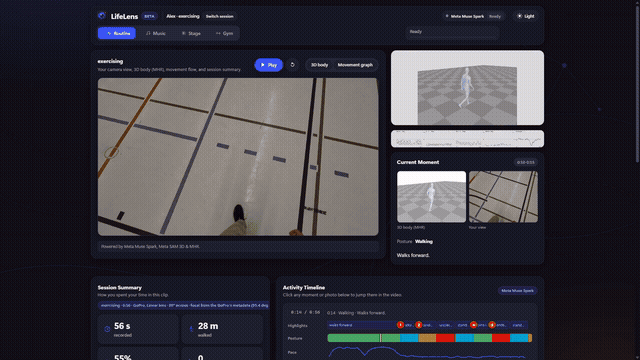
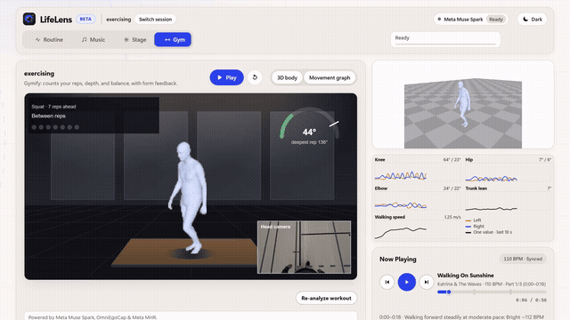
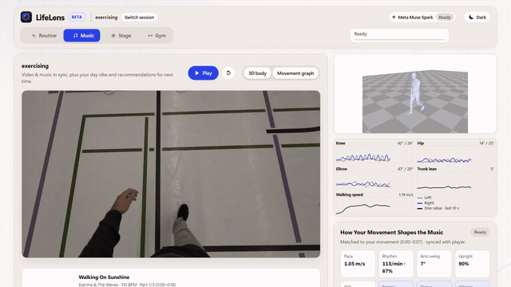
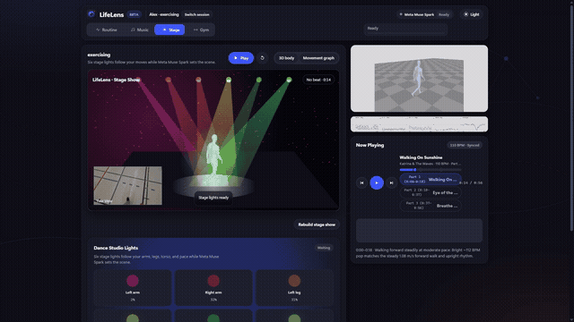

# LifeLens UI & Feedback Systems Guide

Back to [Main README](../README.md) · See also: [Usage & 3D Pipeline](USAGE_AND_PIPELINE.md) · [Meta AI & Open-Source Models](MODELS_AND_ECOSYSTEM.md) · [Technical Deep Dive](DEEP_DIVE.md)

---

## Overview

LifeLens turns a single first-person camera video into an interactive studio experience powered by **[Meta Muse Spark 1.3](https://dev.meta.ai/docs/quickstart)**, **[Meta MHR (Momentum Human Rig)](https://github.com/facebookresearch/momentum)**, **[Meta Llama 3.2](https://ollama.com/library/llama3.2)**, open-source **[OmniEgoCap](https://github.com/MiroPsota/OmniEgoCap)**, and open-source **[ReccoBeats](https://reccobeats.com/)**. Tested on head-mounted GoPro recordings to replicate the first-person perspective of **Meta Ray-Ban Smart Glasses**, the interface is organized into a clean launcher and four focused workspace tabs — **Routine**, **Gym**, **Music**, and **Stage** — designed with friendly, non-technical language and clickable visual feedback cards.

---

## 1. Routine & Relaxed-Life Feedback System (`Routine` Tab)

  

- **Open a Session & Synchronized Playback:** Select any processed session from the launcher and press **Play** to watch your first-person camera POV alongside your reconstructed **3D Meta MHR body mesh** (`mesh_exo.mp4`) and the live movement flow graph.
- **Current Moment Inspection:** Displays the exact first-person activity image and 3D MHR body render that **Meta Muse Spark** inspected for the current 5-second window, evaluating what activity you were doing, how effective it was, and how you feel.
- **Posture Breakdown & Clickable Photo Timeline:** Visualizes your session split across `walking`, `standing`, `sitting`, `crouching`, `bending`, and `arms raised`. Click any 5-second photo card on the timeline to jump the video and 3D MHR mesh to that exact moment.
- **Relaxed-Life & Habit Feedback Cards:** Friendly, visual cards generated by **Meta Muse Spark** highlighting what went well, clickable timestamped posture adjustments for a calmer and more relaxed life, and comparisons across your **Past Sessions**.

---

## 2. Gymify Training Feedback System (`Gym` Tab)

  

- **Automatic Exercise & Effectiveness Recognition:** **Meta Muse Spark** inspects 3D MHR body frames and POV frames over the most active window using MHR joint trajectories to identify the exercise and evaluate movement effectiveness.
- **3D MHR Biomechanical Rep Counting:** Measures every rep directly on the 3D MHR joints (knee flexion, hip hinge, elbow angle, or wrist elevation), computing:
  - **Reps & Sets**
  - **Peak Depth & Range of Motion** (e.g., `136°` squat knee flexion)
  - **Eccentric / Concentric Tempo** (seconds down vs. seconds up)
  - **Left–Right Symmetry** at the bottom of each rep
- **Clickable Per-Rep Form Feedback Cards:** Click **Rep 1**, **Rep 2**, or **Rep 3** cards to inspect visual depth gauges, symmetry bars, and concise form feedback from **Meta Muse Spark**, and jump the 3D MHR body viewer to that rep.
- **Cozy Rest-Day Notice:** When viewing a non-workout clip (such as seated `eating`), Gymify displays a friendly illustrated rest-day card instead of forcing a rep count.

---

## 3. Unified Video & Music Player + Day Vibe (`Music` Tab)

  

- **Unified Video + Music Playback (Powered by Open-Source [ReccoBeats](https://reccobeats.com/)):** Pressing **Play** or clicking any clip segment pill locks the music player to the active movement section so video and soundtrack stay in sync:
  - **20–30 s clips:** Plays **1 best-fitting track** matched via ReccoBeats to the whole clip's pace and energy.
  - **Longer clips:** Automatically transitions tracks across **~20-second movement windows** as your pace, rhythm, and mood shift.
  - **Short clips (< 10 s):** Displays a playful AI DJ warm-up card explaining that a few more seconds of movement help lock in the best track.
- **Your Day Vibe in a Song & Next-Time Picks:** Curates a signature **Day Vibe** track for your session plus recommendations to **Play Next Time You're Doing Similar Tasks**, powered by **Meta Muse Spark** and open-source [ReccoBeats](https://reccobeats.com/).

---

## 4. Dance Choreography & Virtual Stage Performance (`Stage` Tab)

  

- **Center-Stage 3D MHR Performer:** Your 3D MHR body mesh is keyed onto a dark virtual stage with a persistent first-person POV inset so dancers and performers can rehearse choreography smoothly at 60 fps.
- **6 Reactive Lighting Fixtures:** Six virtual stage lights map directly to your 3D MHR body parts (**Left Arm**, **Right Arm**, **Left Leg**, **Right Leg**, **Torso**, and **Pace**), reacting every frame to limb speed, arm spread, jumps, crouches, and turns.
- **Stagify Show Planner & Hardware DMX/Hue Export:** Click **Create full stage show** to let **Meta Muse Spark** design a multi-scene lighting arc (`stage.json`, `stage_cues.csv`) that can drive real-world [Art-Net DMX](https://art-net.org.uk/) fixtures or a [Philips Hue](https://developers.meethue.com/) bridge.
