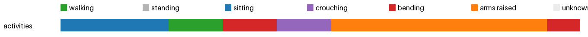

# Activity insights: activities



| | walking | standing | sitting | crouching | bending | arms raised | unknown | sit-downs | longest sit | walked |
|---|---|---|---|---|---|---|---|---|---|---|
| activities | 0.1 min | 0.0 min | 0.2 min | 0.1 min | 0.1 min | 0.3 min | 0.0 min | 2 | 0.2 min | 12 m |
| **total** | 0.1 min | 0.0 min | 0.2 min | 0.1 min | 0.1 min | 0.3 min | 0.0 min | 2 | 0.2 min | 12 m |

<details><summary>Posture log</summary>

```
Total 0.8 min: walking 0.08 min, sitting 0.17 min, crouching 0.08 min, bending 0.13 min, arms raised 0.33 min
2 times sat or crouched down, longest sitting 0.17 min, walked 12.4 m, bent over 0.13 min.
Clip activities:
  sitting 10 s. The camera wearer sits and raises both arms. The camera wearer stands up.
  walking 5 s. The camera wearer walks forward.
  bending 5 s. The camera wearer walks outdoors.
  crouching 5 s. The camera wearer walks while extending their left arm.
  arms raised 20 s. The camera wearer walks forward. The camera wearer stretches both arms. The camera wearer stretches both arms forward. The camera wearer extends both arms forward.
  bending 3 s. Extends both arms forward with clenched fists.
```
</details>
