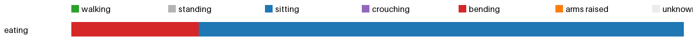

# Activity insights: eating



| | walking | standing | sitting | crouching | bending | arms raised | unknown | sit-downs | longest sit | walked |
|---|---|---|---|---|---|---|---|---|---|---|
| eating | 0.0 min | 0.0 min | 0.3 min | 0.0 min | 0.1 min | 0.0 min | 0.0 min | 1 | 0.3 min | 3 m |
| **total** | 0.0 min | 0.0 min | 0.3 min | 0.0 min | 0.1 min | 0.0 min | 0.0 min | 1 | 0.3 min | 3 m |

<details><summary>Posture log</summary>

```
Total 0.4 min: sitting 0.32 min, bending 0.08 min
1 times sat or crouched down, longest sitting 0.32 min, walked 3.3 m, bent over 0.08 min.
Clip eating:
  bending 5 s. The camera wearer sits down.
  sitting 19 s. The camera wearer stirs noodles in a bowl with a spoon. The camera wearer eats food from a bowl. The camera wearer stirs noodles in a bowl. Stirs noodles in a bowl with a spoon.
```
</details>
