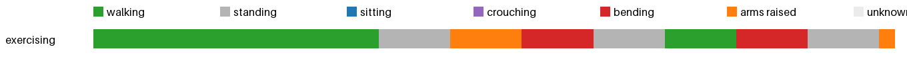

# Activity insights: exercising



| | walking | standing | sitting | crouching | bending | arms raised | unknown | sit-downs | longest sit | walked |
|---|---|---|---|---|---|---|---|---|---|---|
| exercising | 0.4 min | 0.2 min | 0.0 min | 0.0 min | 0.2 min | 0.1 min | 0.0 min | 0 | 0.0 min | 28 m |
| **total** | 0.4 min | 0.2 min | 0.0 min | 0.0 min | 0.2 min | 0.1 min | 0.0 min | 0 | 0.0 min | 28 m |

<details><summary>Posture log</summary>

```
Total 0.93 min: walking 0.42 min, standing 0.25 min, bending 0.17 min, arms raised 0.1 min
0 times sat or crouched down, longest sitting 0.0 min, walked 27.6 m, bent over 0.17 min.
Clip exercising:
  walking 20 s. The camera wearer walks forward. The camera wearer is walking forward.
  standing 5 s. The camera wearer walks then squats down.
  arms raised 5 s. The camera wearer stands and clasps hands together.
  bending 5 s. The camera wearer unclasps their hands.
  standing 5 s. The camera wearer stands up.
  walking 5 s. The camera wearer spins in place.
  bending 5 s. The camera wearer bends to touch their shoes.
  standing 5 s. The camera wearer stands up from a crouch.
  arms raised 1 s. The camera wearer stands still.
```
</details>
