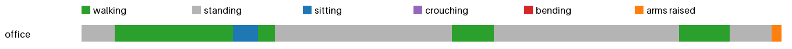

# Activity insights: office



| | walking | standing | sitting | crouching | bending | arms raised | sit-downs | longest sit | walked |
|---|---|---|---|---|---|---|---|---|---|
| office | 0.5 min | 0.9 min | 0.1 min | 0.0 min | 0.0 min | 0.0 min | 1 | 0.1 min | 32 m |
| **total** | 0.5 min | 0.9 min | 0.1 min | 0.0 min | 0.0 min | 0.0 min | 1 | 0.1 min | 32 m |

The person began the day by standing (0:00–0:04), then walked (0:04–0:18) to a door and around the office. They sat briefly (0:21–0:23) to pick up a plastic bag, then stood again (0:23–0:44) while pouring liquid and walking toward a table. They stood (1:11–1:17) while opening a refrigerator and cabinet, then walked (1:17–1:22) to the table and stood (1:22–1:23) before raising their arms. The person spent 0.05 min sitting, 0.45 min walking, and 0.87 min standing, with minimal movement in other postures.

To improve posture and efficiency, the person should: 1) take a 1-minute break every 30 minutes to stand and stretch, reducing prolonged sitting; 2) increase walking time by incorporating 10 minutes of daily walking, especially during breaks; 3) limit arm-raising to 10 seconds or less, as it contributes to poor posture. These changes will reduce strain, improve circulation, and support long-term health.

<details><summary>Log given to the model</summary>

```
Total 1.38 min: walking 0.45 min, standing 0.87 min, sitting 0.05 min, arms raised 0.02 min
1 times sat or crouched down, longest sitting 0.05 min, walked 32.3 m, bent over 0.0 min.
Clip office:
  0:00-0:04 standing. The camera wearer is adjusting their gloves.
  0:04-0:18 walking. The camera wearer is adjusting their gloves. The camera wearer walks towards a door. The camera wearer walks around the office. The camera wearer walks into an office.
  0:18-0:21 sitting. The camera wearer walks into an office. The camera wearer picks up a plastic bag from a table.
  0:21-0:23 walking. The camera wearer picks up a plastic bag from a table.
  0:23-0:44 standing. The camera wearer picks up a plastic bag from a table. The camera wearer is pouring a liquid into a cup. The camera wearer turns on the water dispenser. The camera wearer is walking towards a table.
  0:44-0:49 walking. The camera wearer is walking towards a table. The camera wearer opens a door.
  0:49-1:11 standing. The camera wearer opens a door. The camera wearer opens the refrigerator. The camera wearer opens a refrigerator. The camera wearer opens a cabinet. The camera wearer walks to the table.
  1:11-1:17 walking. The camera wearer walks to the table.
  1:17-1:22 standing. The camera wearer walks to the table. The camera wearer walks around the office.
  1:22-1:23 arms raised. The camera wearer walks around the office.
```
</details>
