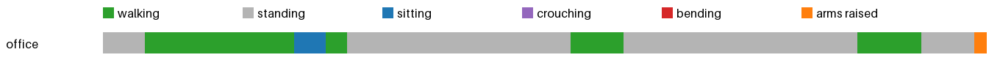

# Activity insights: office



| | walking | standing | sitting | crouching | bending | arms raised | sit-downs | longest sit | walked |
|---|---|---|---|---|---|---|---|---|---|
| office | 0.5 min | 0.9 min | 0.1 min | 0.0 min | 0.0 min | 0.0 min | 1 | 0.1 min | 32 m |
| **total** | 0.5 min | 0.9 min | 0.1 min | 0.0 min | 0.0 min | 0.0 min | 1 | 0.1 min | 32 m |


<details><summary>Log given to the model</summary>

```
Total 1.38 min: walking 0.45 min, standing 0.87 min, sitting 0.05 min, arms raised 0.02 min
1 times sat or crouched down, longest sitting 0.05 min, walked 32.3 m, bent over 0.0 min.
Clip office:
  standing 4 s. The camera wearer is adjusting their gloves.
  walking 14 s. The camera wearer is adjusting their gloves. The camera wearer walks towards a door. The camera wearer walks around the office. The camera wearer walks into an office.
  sitting 3 s. The camera wearer walks into an office. The camera wearer picks up a plastic bag from a table.
  walking 2 s. The camera wearer picks up a plastic bag from a table.
  standing 21 s. The camera wearer picks up a plastic bag from a table. The camera wearer is pouring a liquid into a cup. The camera wearer turns on the water dispenser. The camera wearer is walking towards a table.
  walking 5 s. The camera wearer is walking towards a table. The camera wearer opens a door.
  standing 22 s. The camera wearer opens a door. The camera wearer opens the refrigerator. The camera wearer opens a refrigerator. The camera wearer opens a cabinet. The camera wearer walks to the table.
  walking 6 s. The camera wearer walks to the table.
  standing 5 s. The camera wearer walks to the table. The camera wearer walks around the office.
  arms raised 1 s. The camera wearer walks around the office.
```
</details>
