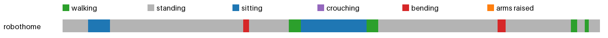

# Activity insights: robothome



| | walking | standing | sitting | crouching | bending | arms raised | sit-downs | longest sit | walked |
|---|---|---|---|---|---|---|---|---|---|
| robothome | 0.3 min | 3.4 min | 0.7 min | 0.0 min | 0.1 min | 0.0 min | 2 | 0.6 min | 50 m |
| **total** | 0.3 min | 3.4 min | 0.7 min | 0.0 min | 0.1 min | 0.0 min | 2 | 0.6 min | 50 m |

The individual began by walking around a room (49.8 m), then stood for 67 seconds while performing tasks like watering plants, pouring water, and handling items such as a water bottle and cleaning supplies. They also sat for 33 seconds on a couch, adjusted pillows, and held a pillow. Afterward, they stood again for 60 seconds while cooking on the stove, opened a cabinet, and adjusted wrist guards. During this period, they bent over briefly to pick up a tray and placed it on a shelf. Finally, they walked around a lab and stood near a table for several seconds before ending the session.

To improve their schedule, consider increasing movement throughout the day—aim for at least 10 minutes of active engagement every hour. Breaks should include stretching or light activity; the current log shows only brief moments of standing and walking. For posture improvement, avoid prolonged sitting by taking regular breaks to stand and move. Additionally, ensure proper ergonomics during seated work by using a supportive chair and maintaining a neutral spine. These adjustments could reduce strain and support overall well-being.

<details><summary>Log given to the model</summary>

```
Total 4.5 min: walking 0.28 min, standing 3.37 min, sitting 0.73 min, bending 0.12 min
2 times sat or crouched down, longest sitting 0.55 min, walked 49.8 m, bent over 0.12 min.
Clip robothome:
  standing 13 s. The camera wearer walks around a room. The camera wearer is walking around a room. The camera wearer sits on a chair.
  sitting 11 s. The camera wearer sits on a chair. The camera wearer is sitting on a chair in front of a washing machine. The camera wearer is sitting on a chair in a room.
  standing 67 s. The camera wearer is sitting on a chair in a room. The camera wearer picks up a chair. The camera wearer is watering the plants. The camera wearer is pouring water from a pitcher into a container. The camera wearer picks up a plant. The camera wearer is watering a plant. The camera wearer is adjusting a plant on a table. The camera wearer is holding a yellow bottle of cleaning solution. The camera wearer places a bottle of dish soap on a table. The camera wearer picks up an apple from the floor. The camera wearer is picking up a yellow object from a shelf. The camera wearer picks up a bottle of water. The camera wearer is holding a water bottle. The camera wearer is opening a bottle of water.
  bending 3 s. The camera wearer is opening a bottle of water.
  standing 20 s. The camera wearer is opening a bottle of water. The camera wearer picks up a water bottle. The camera wearer places a bottle on a table. The camera wearer picks up a chair. The camera wearer is walking through a room with chairs and a table.
  walking 6 s. The camera wearer is walking through a room with chairs and a table. The camera wearer walks around a room.
  sitting 33 s. The camera wearer is sitting on a couch. The camera wearer is sitting on a couch and adjusting their knee pads. The camera wearer is sitting on a couch and adjusting a pillow. The camera wearer is sitting on a couch and holding a pillow.
  walking 6 s. The camera wearer is sitting on a couch and adjusting a pillow. The camera wearer walks around a room.
  standing 60 s. The camera wearer walks around a room. The camera wearer walks around a cluttered room. The camera wearer picks up a pot. The camera wearer places a pan on the stove. The camera wearer turns on the stove. The camera wearer is cooking on the stove. The person is cooking on the stove. The camera wearer opens a cabinet. The camera wearer is adjusting a wooden board. The camera wearer is adjusting their wrist guards.
  bending 4 s. The camera wearer is adjusting their wrist guards. The camera wearer picks up a white tray from the floor.
  standing 33 s. The camera wearer picks up a white tray from the floor. The camera wearer is holding a white plastic container and placing it on a wooden shelf. The camera wearer turns on the water cooler. The camera wearer walks to a table. The camera wearer picks up a bottle from the table. The camera wearer is opening a bottle of water. The camera wearer walks toward the wall. The camera wearer walks around a lab.
  walking 3 s. The camera wearer walks around a lab.
  standing 4 s. The camera wearer walks around a lab. The camera wearer walks towards a table.
  walking 2 s. The camera wearer walks towards a table.
  standing 5 s. The camera wearer walks around a cluttered room.
```
</details>
