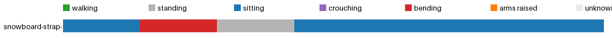

# Activity insights: snowboard-strap-in



| | walking | standing | sitting | crouching | bending | arms raised | unknown | sit-downs | longest sit | walked |
|---|---|---|---|---|---|---|---|---|---|---|
| snowboard-strap-in | 0.0 min | 0.1 min | 0.4 min | 0.0 min | 0.1 min | 0.0 min | 0.0 min | 2 | 0.3 min | 10 m |
| **total** | 0.0 min | 0.1 min | 0.4 min | 0.0 min | 0.1 min | 0.0 min | 0.0 min | 2 | 0.3 min | 10 m |

<details><summary>Posture log</summary>

```
Total 0.58 min: standing 0.08 min, sitting 0.42 min, bending 0.08 min
2 times sat or crouched down, longest sitting 0.33 min, walked 9.9 m, bent over 0.08 min.
Clip snowboard-strap-in:
  sitting 5 s. The camera wearer sits on the snow and adjusts their snowboard boot.
  bending 5 s. The camera wearer straps into a snowboard.
  standing 5 s. The camera wearer straps into a snowboard.
  sitting 20 s. The camera wearer puts on a snowboard. The camera wearer straps boots onto a snowboard. The camera wearer fastens their snowboard binding. The camera wearer straps into a snowboard.
```
</details>
