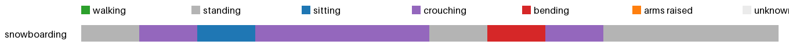

# Activity insights: snowboarding



| | walking | standing | sitting | crouching | bending | arms raised | unknown | sit-downs | longest sit | walked |
|---|---|---|---|---|---|---|---|---|---|---|
| snowboarding | 0.0 min | 0.4 min | 0.1 min | 0.4 min | 0.1 min | 0.0 min | 0.0 min | 2 | 0.4 min | 6 m |
| **total** | 0.0 min | 0.4 min | 0.1 min | 0.4 min | 0.1 min | 0.0 min | 0.0 min | 2 | 0.4 min | 6 m |

<details><summary>Posture log</summary>

```
Total 1.0 min: standing 0.42 min, sitting 0.08 min, crouching 0.42 min, bending 0.08 min
2 times sat or crouched down, longest sitting 0.42 min, walked 5.9 m, bent over 0.08 min.
Clip snowboarding:
  standing 5 s. The camera wearer snowboards downhill.
  crouching 5 s. The camera wearer snowboards downhill.
  sitting 5 s. The camera wearer snowboards downhill.
  crouching 15 s. The camera wearer is snowboarding. The camera wearer snowboards downhill. The camera wearer snowboards down a snowy slope.
  standing 5 s. The camera wearer snowboards downhill.
  bending 5 s. The camera wearer snowboards down a snowy slope.
  crouching 5 s. The camera wearer is snowboarding down a slope.
  standing 15 s. The camera wearer snowboards down a snowy slope. The camera wearer is snowboarding. The camera wearer snowboards down a slope.
```
</details>
