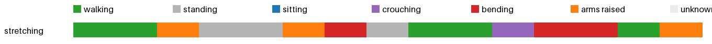

# Activity insights: stretching



| | walking | standing | sitting | crouching | bending | arms raised | unknown | sit-downs | longest sit | walked |
|---|---|---|---|---|---|---|---|---|---|---|
| stretching | 0.4 min | 0.2 min | 0.0 min | 0.1 min | 0.2 min | 0.2 min | 0.0 min | 1 | 0.1 min | 30 m |
| **total** | 0.4 min | 0.2 min | 0.0 min | 0.1 min | 0.2 min | 0.2 min | 0.0 min | 1 | 0.1 min | 30 m |

<details><summary>Posture log</summary>

```
Total 1.25 min: walking 0.42 min, standing 0.25 min, crouching 0.08 min, bending 0.25 min, arms raised 0.25 min
1 times sat or crouched down, longest sitting 0.08 min, walked 29.8 m, bent over 0.25 min.
Clip stretching:
  walking 10 s. The camera wearer walks forward.
  arms raised 5 s. The camera wearer walks then checks his wrist.
  standing 10 s. The camera wearer performs a squat. The camera wearer stands with hands clasped.
  arms raised 5 s. The camera wearer stands up from a seated position.
  bending 5 s. The camera wearer stumbles sideways with arms raised.
  standing 5 s. The camera wearer walks with arms outstretched.
  walking 10 s. The camera wearer walks forward while balancing with arms. The camera wearer walks forward.
  crouching 5 s. The camera wearer walks while adjusting their pants.
  bending 10 s. The camera wearer walks forward. The camera wearer balances on one leg.
  walking 5 s. The camera wearer walks forward.
  arms raised 5 s. The camera wearer walks forward.
```
</details>
